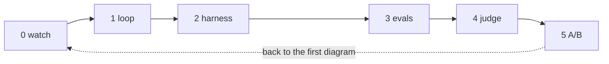

# agent-game

A hands-on walk from "what is Claude Code actually doing" to "how do I know if my agent is any good," built as six folders you work through in order. Each level has one README that says what it is, what to type, and what to notice while it runs.

```
level0_watch     watch Claude Code do a task; name the loop
level1_loop      build the loop yourself in ~70 lines
level2_harness   add the box around the loop: prompt, cap, permissions
level3_evals     grade the agent with code, N runs, see a pass rate
level4_judge     grade text outputs with a rubric + a judge model; calibrate
level5_ab        change one line of the harness, re-run everything, compare
```



## Setup

Needs Python 3.10+, Claude Code installed, and an Anthropic API key.

```
git clone https://github.com/MarinaWyss/agent-game.git && cd agent-game
./setup.sh
```

`setup.sh` makes a virtualenv, installs the two dependencies (`anthropic`, `pytest`), copies `.env.example` to `.env`, and creates the `workspace/` folder. Put your key in `.env`. Then check it works:

```
source .venv/bin/activate
python -m harness.workspace          # resets the toy project
cd workspace && python -m pytest -q  # should show 1 failing test
```

## How to play

Open `level0_watch/README.md`. Do what it says. When you're done, open `level1_loop/README.md`. Repeat.

Every level's README has the same three sections: **What this is**, **Type this**, **What to notice**. The diagrams are Mermaid: github.com and Obsidian render them natively; VS Code needs the "Markdown Preview Mermaid Support" extension. Keep the current README open next to your terminal and you never have to think about what's next.

`FAQ.md` has the questions that come up at each level, with short answers and links to the docs. Worth a read before you start.

## Layout

```
harness/            the shared agent loop + tools + SYSTEM.md (levels 2 to 5 import from here)
_pristine/workspace the toy project in its starting state; never edit this directly
workspace/          a fresh copy of _pristine, reset before every run (gitignored)
level*/             one folder per level
```

The toy project is three small functions in `utils.py`, four tests (one deliberately failing), a log file, and a stack trace. Dull on purpose. The point is the agent, not the code.

## Models

`AGENT_MODEL` does the work, `JUDGE_MODEL` grades it. Defaults are in `harness/__init__.py` and can be overridden in `.env`. They are different models on purpose; level 4 explains why. Claude model IDs are pinned snapshots, so results stay comparable until you change the string. If a default model is retired when you run this, change it in `.env` and update `PRICES` in `harness/__init__.py`.

## Cost

Roughly 50 to 60 agent runs across all six levels if you follow every "Type this" block, most under 15 turns on a tiny codebase. Every run summary and eval table shows an estimated cost (list prices in `harness/__init__.py`; output tokens include the model's thinking). Set a spend limit in the Anthropic Console anyway.

## If something breaks

Each level README has an "if this goes sideways" note at the bottom. The general escape hatches:

- `python -m harness.workspace` resets the toy project.
- `level1_loop/solution/agent.py` is the finished loop if the build stalls.
- Every eval run saves full transcripts to `results/`. If the API is slow or down, you can still read through a previous run's results.
