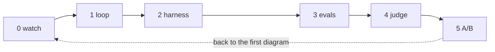

# agent-game

What is Claude Code actually doing when it fixes your bug? And once you build something like it yourself, how do you know if it's any good?

This repo walks through both questions in six small levels. Each level is one folder with one README that tells you what it is, what to type, and what to look for while it runs. You do them in order.

```
level0_watch     watch Claude Code do a task; name the loop
level1_loop      build the loop yourself in ~70 lines
level2_harness   add the box around the loop: prompt, cap, permissions
level3_evals     grade the agent with code, N runs, see a pass rate
level4_judge     grade text outputs with a rubric + a judge model; calibrate
level5_ab        change one line of the harness, re-run everything, compare
```



## Setup

You need Python 3.10+, Claude Code installed, and an Anthropic API key.

```
git clone https://github.com/MarinaWyss/agent-game.git && cd agent-game
./setup.sh
```

`setup.sh` makes a virtualenv, installs the two dependencies (`anthropic` and `pytest`), copies `.env.example` to `.env`, and creates the `workspace/` folder. Put your key in `.env`, then check that everything works:

```
source .venv/bin/activate
python -m harness.workspace          # resets the toy project
(cd workspace && python -m pytest -q)  # should show 1 failing test
```

That one failing test is on purpose. It's the bug the agent fixes in every level.

## How to play

Open `level0_watch/README.md` and do what it says. When you're done, open `level1_loop/README.md`. Repeat.

Every level's README has the same sections: **Why this level**, **What this is**, **Type this**, **What to notice**, and **Questions you might have** at the end. I'd suggest keeping the current README open next to your terminal so you never have to think about what's next.

The diagrams are Mermaid. GitHub and Obsidian draw them for you; VS Code needs the "Markdown Preview Mermaid Support" extension.

## Layout

```
harness/            the shared agent loop + tools + SYSTEM.md (levels 2 to 5 import from here)
_pristine/workspace the toy project in its starting state; never edit this directly
workspace/          a fresh copy of _pristine, reset before every run (gitignored)
level*/             one folder per level
```

The toy project is three small functions in `utils.py`, four tests (one deliberately failing), a log file, and a stack trace. It's boring on purpose. The point is the agent, not the code.

## Models

`AGENT_MODEL` does the work and `JUDGE_MODEL` grades it. The defaults are in `harness/__init__.py`, and you can override either one in `.env`. They're different models on purpose (level 4 explains why).

Claude model IDs are pinned snapshots, so your results stay comparable until you change the string. If a default model has been retired by the time you run this, change it in `.env` and update `PRICES` in `harness/__init__.py`.

## Cost

If you follow every "Type this" block, it's roughly 50 to 60 agent runs across all six levels, most of them under 15 turns on a tiny codebase. Every run summary and eval table shows an estimated cost, based on the list prices in `harness/__init__.py`. (Output tokens include the model's thinking, so they'll be higher than the text you see.)

Set a spend limit in the Anthropic Console anyway. It's cheap insurance.

## If something breaks

Each level README has a note at the bottom for when things go sideways. The general escape hatches:

- `python -m harness.workspace` resets the toy project.
- `level1_loop/solution/agent.py` is the finished loop, if the build in level 1 stalls.
- Every eval run saves full transcripts to `results/`. If the API is slow or down, you can still read through a previous run.

A few setup gotchas:

- **`pytest: command not found` inside the agent's shell.** The agent's `run_shell` inherits your environment, so activate the venv (`source .venv/bin/activate`) in the terminal you run the levels from. The level 3 checks use `sys.executable`, so they're fine either way, but the agent isn't.
- **`workspace/` gets wiped before every run.** Don't put anything you care about in there. `_pristine/workspace/` is the original.
- **API key.** Put it in `.env` (which is gitignored), and `harness/__init__.py` loads it. Claude Code's own login is separate (a subscription, or `claude auth login --console` for API billing).
- **Mac and Linux only**, as written. On Windows, use WSL.
- **The costs shown are estimates** based on the list prices in `harness/__init__.py`, meant for comparing versions. Your actual invoice is the source of truth.
