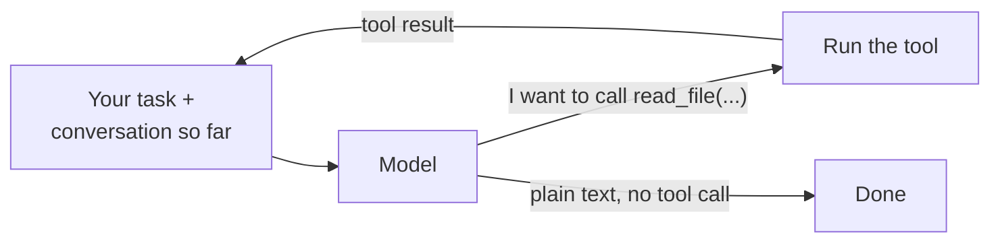

# Level 0: Watch the loop

**Goal:** see Claude Code do a task and name the four steps it repeats.

## What this is

Claude Code is a loop. It asks the model what to do, the model asks for a tool, Claude Code runs the tool and sends the result back, and the model decides again. It stops when the model answers without asking for a tool. Everything else (permissions, the CLAUDE.md file, context management) is scaffolding around that loop.



## Type this

Open a terminal in the `workspace/` folder and start Claude Code. Then give it one task:

```
cd workspace
claude
```

```
Run the tests and fix whatever fails.
```

Press **Ctrl+O** to open the transcript viewer so the full tool calls and results are visible instead of collapsed (or start it as `claude --verbose`).

## What you should see

The task is designed so there is only one sensible path. Expect roughly this sequence of tool calls:

1. `Bash: python -m pytest -q` (one failure: `test_slugify_lowercases`)
2. `Read: test_utils.py`
3. `Read: utils.py`
4. `Edit: utils.py` (adds `.lower()`)
5. `Bash: python -m pytest -q` (all pass)
6. Final message, no tool call. Loop ends.

Each numbered step is one trip around the diagram. Point at the screen and the diagram at the same time.

## Talk about this while it runs

- Every tool call is the model *asking*. Claude Code decides whether to run it. That gap is where permissions live.
- `workspace/CLAUDE.md` told it to run tests first and announce each step. Claude Code loads that file into the context at startup, from the working directory and its parents; it's the part of the system prompt you control. Open the file and show it. (Your own mini agent in level 1 won't read it. Only Claude Code does. Remember that when the mini agent edits a test in level 3.)
- Ask your guest: what does it need to know to make the second `pytest` call? (Answer: the result of the `Edit`, which is why results get fed back into the conversation. The conversation *is* the agent's memory.)

## If the live run goes sideways

Reset with `python -m harness.workspace` from the repo root and try once more. If it does something strange, that's also a conversation: the loop is the same, the model made a different choice. Move on to level 1, where you build the loop yourselves and it's fully under your control.
