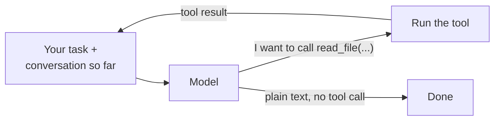

# Level 0: Watch the loop

**Goal:** see Claude Code do a task and name the four steps it repeats.

## Why start here

People say Claude Code is "an agent." That word gets used for a lot of things, so here's what it means in this repo.

A **model** on its own is a text-in, text-out function. You send it a conversation, it sends back the next message. It can't run your tests, open a file, or check whether its answer worked. A chatbot is a model plus a chat window: it answers, and then it waits for you.

An **agent** is a model plus a program that lets it act and see what happened. The program gives the model a list of tools ("you can run a shell command," "you can read a file"). When the model replies with "run `pytest`," the program runs `pytest` and sends the output back as the next message. Then it asks the model again. It keeps going until the model replies without asking for anything. The model does the deciding. The program does the doing, and it decides what the model is allowed to do.

That program is a loop, and the loop is surprisingly small. Claude Code is that loop plus a lot of careful engineering around it: well-designed tools, permission prompts, CLAUDE.md files, context management. Under all of that, it's the same four steps over and over.

The point of this level is to watch a real agent work on a task small enough that you can follow every step, and match each step to the diagram below. In level 1 you build the same loop yourself in about 70 lines. Everything after that (the harness, the evals) is about the box around the loop and how to tell whether it's any good.

## What this is

Claude Code is a loop. It asks the model what to do, the model asks for a tool, Claude Code runs the tool and sends the result back, and the model decides again. It stops when the model answers without asking for a tool. Everything else (permissions, the CLAUDE.md file, context management) is scaffolding around that loop.



## Type this

**Start Claude Code from inside `workspace/`, not from the repo root.** This matters. Claude Code reads `CLAUDE.md` from the folder it starts in and from that folder's parents, never from subfolders. Start it in the repo root and it won't see `workspace/CLAUDE.md`. It will see the whole workshop instead (READMEs, `_pristine/`, the level folders) and spend its first few turns working out what this repo is.

From the repo root:

```
source .venv/bin/activate
python -m harness.workspace
cd workspace
pwd          # should end in /agent-game/workspace
claude --verbose
```

Activating the venv first means `pytest` is on the path for Claude Code's shell. Resetting the workspace puts the failing test back if you already fixed it earlier.

Then give it one task:

```
Run the tests and fix whatever fails.
```

`--verbose` shows the full tool calls and results instead of collapsing them. (Inside a session, **Ctrl+O** toggles the same transcript view.) Claude Code may ask permission before it runs a shell command or edits a file; say yes. If you've set it to auto-approve, it won't ask, and that's fine too.

## What you should see

The task is designed so there is only one sensible path. Expect roughly this sequence of tool calls:

1. `Bash: python -m pytest -q` (one failure: `test_slugify_lowercases`)
2. `Read: test_utils.py`
3. `Read: utils.py`
4. `Edit: utils.py` (adds `.lower()`)
5. `Bash: python -m pytest -q` (all pass)
6. Final message, no tool call. Loop ends.

The details will vary. It might read both files in one turn, or make the edit through `Bash` instead of `Edit`. The shape stays the same: run the tests, look, change, run the tests again, stop. Each numbered step is one trip around the diagram. Match what's on screen to the diagram as it goes.

**If its first move is `ls` on a folder full of `level*` directories, or it reads the top-level `README.md`,** you started it in the repo root. Quit (`/exit`), `cd workspace`, and start again. It's also a nice preview of level 2: same model, same task, different context, different behavior.

## How to read the transcript

The output mixes three kinds of lines. Telling them apart is how you see the loop.

```
I'll run the test suite first to see what's failing.      <- the model talking

⏺ Bash(python -m pytest -q 2>&1 | tail -40)               <- the model ASKING for a tool
  .F..                                       [100%]       <- what Claude Code ran and sent back
  FAILED test_utils.py::test_slugify_lowercases ...
  1 failed, 3 passed in 0.02s

One failure: slugify doesn't lowercase. I'll look at       <- the model again, having read the result
the source and the tests.

⏺ Bash(ls && cat utils.py test_utils.py)                   <- next request: one more trip around the loop
```

- **A `⏺` line is a request, not an action.** The model can't run anything. Its reply contains a structured message that amounts to "please call the `Bash` tool with this command." The `⏺` line is Claude Code showing you that request: the tool name, and the arguments in parentheses.
- **The indented text under a `⏺` line is the tool result.** Claude Code ran the command itself, captured the output, and added it to the conversation as the next message. That's the arrow from "Run the tool" back to the top of the diagram.
- **Plain sentences are the model's own text.** It writes one before each request because `workspace/CLAUDE.md` tells it to. Watch how each sentence reacts to the result just above it: it decides what to do next only after it has seen what happened.
- **The last message has no `⏺` line after it.** That's the "plain text, no tool call" exit. The model stopped asking, so the loop stopped.

So each `⏺` line plus its result is one trip around the diagram. Count them, and you've counted the loop.

Between the request and the result, Claude Code decides whether to run the command at all. With default settings you see that as a permission prompt. With auto-approve on, it happens silently: your settings said yes before the model asked. Either way the model only asked. Level 2 makes this gap visible on purpose: the harness stops and asks `allow? [y/N]` before every shell command.

## What to notice

- Every tool call is the model *asking*. Claude Code decides whether to run it. That gap is where permissions live.
- `workspace/CLAUDE.md` told it to run tests first and announce each step. Claude Code loads that file into the context at startup; it's the part of the system prompt you control. Open the file and read it. (Your own mini agent in level 1 won't load it automatically. Only Claude Code does; the mini agent only sees it if it happens to `read_file` it. Remember that when the mini agent edits a test in level 3.)
- What does the model need to know to make the second `pytest` call? The result of the edit, which is why results get fed back into the conversation. The conversation *is* the agent's memory.

## If the run goes sideways

Reset with `python -m harness.workspace` from the repo root and try once more. If it does something strange, that's also worth a look: the loop is the same, the model made a different choice. Move on to level 1, where you build the loop yourself and it's fully under your control.
