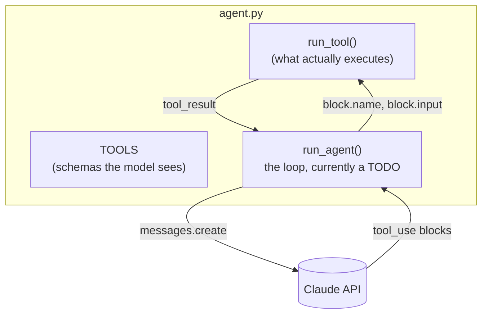

# Level 1: Build the loop

**Goal:** a working coding agent in ~70 lines.

## Why this level

Level 0 showed you the loop from the outside. You saw requests and results go by, but Claude Code's own code stayed hidden. In this level you write the loop yourself, so nothing is hidden.

The thing that surprises most people is how little there is. One API call inside a `while` loop, a check for whether the model asked for a tool, a function that runs the tool, and a list of messages that grows every turn. That's it. There's no planner, no memory store, no special "agent" API. It's the same model you'd chat with; the loop is what turns it into an agent.

**What to expect.** Claude Code fills in about 30 lines of the TODO. Then you run your agent on the same task as level 0, and it fixes the same bug in about five turns. Its output is plainer than Claude Code's: it prints `->` for each request and `<-` for each result. Those are the same request/result pairs as the `⏺` lines in level 0, just without the nice formatting.

It's also rough on purpose. There's no turn limit, no permission check, and every shell command just runs. Don't fix that here (that's what level 2 is for).

**Why it matters.** Once you've written the loop, every agent product gets easier to read. You can ask the same three questions of any of them: what tools does it have, what does it do with the results, and when does it stop?

## What this is

`agent.py` has three tools defined and a function that runs them. The loop itself is a TODO, with the steps spelled out in comments. You hand the TODO to Claude Code, it fills it in, and then you run your agent on the same task from level 0 and compare transcripts.



## Type this

From the repo root, reset the workspace so the test is broken again. Then start Claude Code in the repo root (not in `workspace/` this time):

```
python -m harness.workspace
claude
```

```
Fill in the TODO in level1_loop/agent.py. Follow the numbered steps in the comment exactly. Don't change anything else in the file.
```

When it's done, run your agent:

```
python level1_loop/agent.py "Run the tests and fix whatever fails."
```

## What you should see

Pretty much the same transcript as level 0: pytest, read, read, write, pytest, summary. Yours prints `->` for each tool call and `<-` for each result, so the loop is right there as text.

## What to notice

- There's no magic layer. The "agent" is the `while True`. The model is stateless, so the `messages` list is the only memory it has, and it grows every turn.
- `stop_reason != "tool_use"` is the exit condition. The agent decides when it's finished, not you. (What could go wrong with that? Hold that thought for level 2.)
- Step 2 says to append `response.content` _exactly as returned_. That's because current models think before they act, and the thinking comes back as blocks with signatures the API needs to see again on the next request. If you rebuild the message from just the text, the next call fails. It's also why `max_tokens` is 16000 for what ends up as a one-paragraph reply: the thinking counts.
- Your agent used `write_file` where Claude Code used `Edit`. Claude Code has a dozen tools tuned for code, and yours has three generic ones. Same loop, better tools.
- What's missing from this agent? The usual answers: no limit on turns, `run_shell` runs anything with no questions asked, and there's barely a system prompt. All correct, and all level 2.

## If the build stalls

`solution/agent.py` is the finished version. Run that instead, and diff it against `agent.py` to see what Claude Code was about to write.
