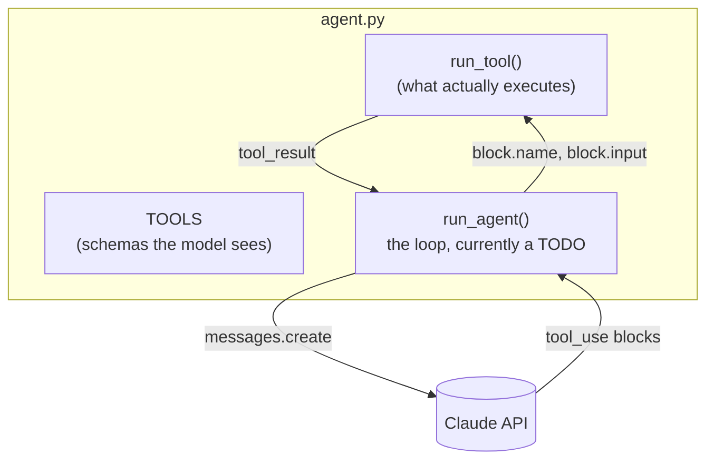

# Level 1: Build the loop

**Goal:** a working coding agent in ~70 lines, written live.

## What this is

`agent.py` has three tools defined and a function that runs them. The loop is a TODO with the steps spelled out in comments. You hand the TODO to Claude Code, it fills it in, you run it on the same task from level 0 and compare transcripts.



## Type this

From the repo root, reset the workspace so the test is broken again, then open Claude Code in the repo root (not in `workspace/` this time):

```
python -m harness.workspace
claude
```

```
Fill in the TODO in level1_loop/agent.py. Follow the numbered steps in the comment exactly. Don't change anything else in the file.
```

When it's done, run your agent:

```
python level1_loop/agent.py "Run the tests and fix whatever fails."
```

## What you should see

Nearly the same transcript as level 0: pytest, read, read, write, pytest, summary. Yours prints `->` for each tool call and `<-` for each result, so the loop is visible as text.

## Talk about this while it runs

- There is no magic layer. The "agent" is the `while True`. The model is stateless; the `messages` list is the only memory, and it grows every turn.
- `stop_reason != "tool_use"` is the exit condition. The agent decides when it's finished, not you. (What could go wrong with that? Hold the thought for level 2.)
- Step 2 says append `response.content` *exactly as returned*. That's because current models think before they act, and the thinking comes back as blocks with signatures the API has to see again on the next request. Rebuild the message from the text and the next call fails. It's also why `max_tokens` is 16000 for a one-paragraph reply: the thinking counts.
- Your agent used `write_file` where Claude Code used `Edit`. Claude Code has a dozen tools tuned for code; yours has three generic ones. Same loop, better tools.
- Ask your guest to spot what's missing. Common answers: no limit on turns, `run_shell` runs anything with no questions asked, no system prompt to speak of. All correct. That's level 2.

## If the live build stalls

`solution/agent.py` is the finished version. Run it instead and show the diff to `agent.py` if you want to see what Claude Code was about to write.
