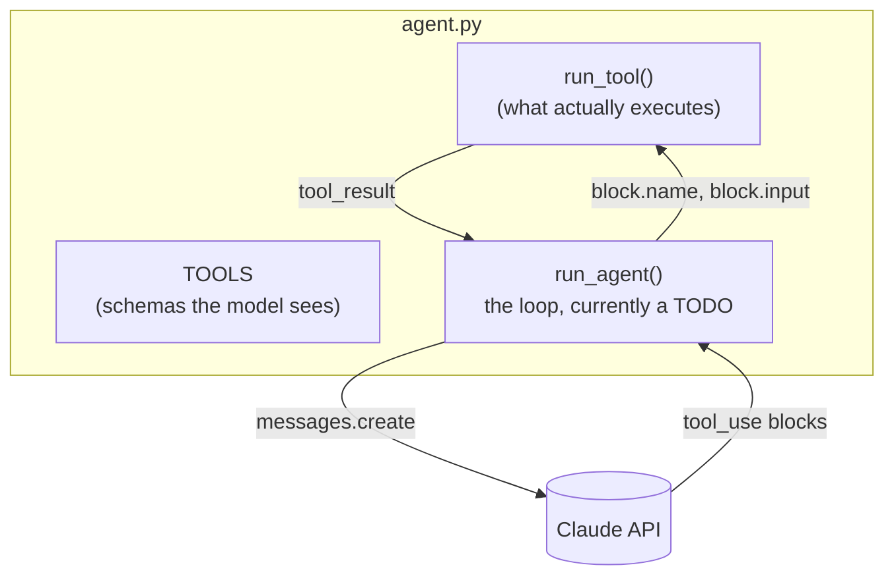

# Level 1: Build the loop

**Goal:** a working coding agent in ~70 lines.

## Why this level

Level 0 showed you the loop from the outside. You saw requests and results go by, but Claude Code's own code stayed hidden. In this level you write the loop yourself, so nothing is hidden.

The thing that surprises most people is how little there is. One API call inside a `while` loop, a check for whether the model asked for a tool, a function that runs the tool, and a list of messages that grows every turn. That's it. There's no planner, no memory store, no special "agent" API. It's the same model you'd chat with; the loop is what turns it into an agent.

**What to expect.** Claude Code fills in about 30 lines of the TODO. Then you run your agent on the same task as level 0, and it fixes the same bug in about five turns. Its output is a lot plainer than Claude Code's: the model's text, plus one line for each tool it asks for. (There's a walkthrough of a real run below.)

It's also rough on purpose. There's no turn limit, no permission check, and every shell command just runs. Don't fix that here (that's what level 2 is for).

**Why it matters.** Once you've written the loop, every agent product gets easier to read. You can ask the same three questions of any of them: what tools does it have, what does it do with the results, and when does it stop?

## What this is

`agent.py` has three tools defined and a function that runs them. The loop itself is a TODO, with the steps spelled out in comments. You hand the TODO to Claude Code, it fills it in, and then you run your agent on the same task from level 0 and compare transcripts.



## Type this

From the repo root, reset the workspace so the test is broken again. Then start Claude Code in the repo root (not in `workspace/` this time):

```
python -m harness.workspace
claude
```

```
Fill in the TODO in level1_loop/agent.py. Follow the numbered steps in the comment exactly. Don't change anything else in the file.
```

When it's done, run your agent:

```
python level1_loop/agent.py "Run the tests and fix whatever fails."
```

## What you should see

Pretty much the same story as level 0: run the tests, read the files, write the fix, run the tests again, summarize. The exact formatting depends on what Claude Code wrote for you, since the TODO only asks it to print the model's text and each tool request. Here's a real run, trimmed a bit:

```
> run_shell {'command': 'python -m pytest 2>&1 | tail -50; ls'}     <- a request
> read_file {'path': 'utils.py'}                                     <- three requests, back to back
> read_file {'path': 'CLAUDE.md'}
> read_file {'path': 'test_utils.py'}
I'm fixing `slugify` in `utils.py` so it lowercases the title.       <- the model talking
> write_file {'path': 'utils.py', 'content': '"""Tiny utility ...'}  <- the fix, as a whole new file
Next I'm re-running the tests to confirm the fix.
> run_shell {'command': 'python -m pytest -q 2>&1 | tail -10'}
All 4 tests pass now. ...                                            <- no request after this, so the loop ends
I missed two steps in `CLAUDE.md`. ...
```

- **A `>` line is a request.** It's your loop printing the tool name and arguments the model asked for, right before `run_tool()` runs it. Same thing as the `⏺` lines in level 0, minus the nice formatting.
- **You don't see the results.** Your loop runs each tool and sends the output back to the model, but the TODO never asked it to print that output, so it doesn't. The model still sees everything. If you want to see it too, add a `print(output)` after `run_tool()` in step 5. (`solution/agent.py` prints a short `<-` line for each result.)
- **Plain lines are the model's text.** That includes the summary at the end, which is the reply with no tool request in it.

There's no turn counter here either, so you can't see where one trip around the loop ends and the next begins. Level 2 adds that.

## What to notice

- There's no magic layer. The "agent" is the `while True`. The model is stateless, so the `messages` list is the only memory it has, and it grows every turn.
- `stop_reason != "tool_use"` is the exit condition. The agent decides when it's finished, not you. (What could go wrong with that? Hold that thought for level 2.)
- Step 2 says to append `response.content` _exactly as returned_. That's because current models think before they act, and the thinking comes back as blocks with signatures the API needs to see again on the next request. If you rebuild the message from just the text, the next call fails. It's also why `max_tokens` is 16000 for what ends up as a one-paragraph reply: the thinking counts.
- Your agent used `write_file` where Claude Code used `Edit`. Claude Code has a dozen tools tuned for code, and yours has three generic ones. Same loop, better tools.
- What's missing from this agent? The usual answers: no limit on turns, `run_shell` runs anything with no questions asked, and there's barely a system prompt. All correct, and all level 2.

## If the build stalls

`solution/agent.py` is the finished version. Run that instead, and diff it against `agent.py` to see what Claude Code was about to write.

## Questions you might have

**Why did it read `CLAUDE.md`, and then apologize for not following it?**
Your agent doesn't load `CLAUDE.md` the way Claude Code does. Its whole system prompt is one sentence. So it ran the tests first with no project instructions at all, saw `CLAUDE.md` in the `ls` output, and decided to read it. By then it had already broken two of the rules (it ran `pytest` without `-q`, and it didn't explain its first few steps), so it followed them from then on and owned up at the end.

That's the difference between instructions in the context from the start and instructions the agent happens to find halfway through. Same file, same model, different behavior, depending on when the words showed up.

**Why does the first command run `pytest` and `ls` together?**
Every request costs a full trip around the loop, so models tend to bundle things into one shell command. Run the tests, and while you're at it, list the files. It's a reasonable move, and it's also why `run_shell` is the most powerful (and most dangerous) tool here: one request can do a lot.

**What if the model asks for two tools at once?**
It can, and it does. The three `read_file` lines in the run above most likely arrived in one reply (level 2 prints turn numbers, and there they show up together). All of the `tool_result` blocks have to go back in a single user message, in any order. Miss one and the API returns a 400 error. That's what step 6 of the TODO is about. [Handle tool calls](https://platform.claude.com/docs/en/agents-and-tools/tool-use/handle-tool-calls), [Parallel tool use](https://platform.claude.com/docs/en/agents-and-tools/tool-use/parallel-tool-use)

**Why does the agent resend the whole conversation every turn?**
Because the API is stateless. Every request is the full transcript: system prompt, tools, and every message so far. That's why the `messages` list grows and why each turn costs a bit more than the last. Eventually the context fills up, too (Claude Code summarizes old turns when that happens). Level 2 adds prompt caching, which takes care of most of the cost. [Prompt caching](https://platform.claude.com/docs/en/build-with-claude/prompt-caching)

**Why is `max_tokens` 16000 when the replies are a paragraph long?**
Current models think before they answer, and thinking tokens count against `max_tokens` (and get billed as output). With a small limit, the model gets cut off mid-thought or mid-tool-call. The level 2 harness also handles that case: if the model runs out of room in the middle of a tool request, it retries with a bigger limit instead of running a half-written request. [Thinking](https://platform.claude.com/docs/en/build-with-claude/thinking), [Stop reasons](https://platform.claude.com/docs/en/build-with-claude/handling-stop-reasons)

**What are the `thinking` blocks in `response.content`?**
That's the model's reasoning. It's hidden by default (`display: omitted`), but it's still there as a block with a cryptographic signature. You have to send those blocks back unchanged on the next request, or the API rejects the conversation. That's why step 2 says to append `response.content` exactly as returned. If you ever filter blocks by type, keep `thinking` and `redacted_thinking`.

**Why custom `read_file` / `write_file` / `run_shell` tools instead of Anthropic's `bash` and `text_editor`?**
Anthropic publishes schemas for `bash`, `text_editor`, `memory`, and a few others that the model was trained on, so it uses them more reliably. This repo defines its own so you can see that a tool is nothing more than a JSON schema and a function. In a real harness, I'd use the built-in schemas wherever they fit. [Tool reference](https://platform.claude.com/docs/en/agents-and-tools/tool-use/tool-reference)

**Why write the loop at all? Doesn't the SDK have one?**
It does. The Tool Runner handles the `tool_use` loop, result formatting, and retries, and the Agent SDK gives you Claude Code's whole harness as a library. Use those for real work! We write the loop once here so there's no mystery about what they're doing for you. [Tool Runner](https://platform.claude.com/docs/en/agents-and-tools/tool-use/tool-runner), [Agent SDK](https://code.claude.com/docs/en/agent-sdk/overview)

**Why does the fix rewrite the whole file?**
Because `write_file` replaces the whole file. The model sent back the entire contents of `utils.py` with one word changed. Claude Code's `Edit` tool sends just the old and new snippet instead, which is cheaper and much harder to get wrong on a big file. Tool design matters!
