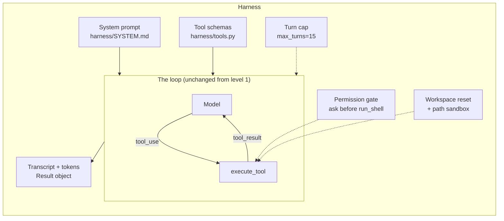

# Level 2: The harness

**Goal:** name everything around the loop, and feel why each piece exists.

## Why this level

The loop from level 1 works, but you wouldn't let it near a real codebase. It runs any command it's asked to, it keeps going as long as the model keeps asking, and it leaves no record of what happened. A **harness** is everything you put around the loop to fix that: what the model is told, what it's allowed to do, when it has to stop, and what gets written down.

Most of what makes Claude Code good is harness, not model. The same model in a worse harness is a worse agent.

**What to expect.** You run the agent twice. The first time, the harness stops before every shell command and asks `allow? [y/N]`. Say yes once, then say no, and watch what happens. The model gets a `DENIED` result, and it has to deal with that the way it would deal with any other result: usually it explains that it couldn't check its fix and tells you how to check it yourself. The second time, the turn limit is 2. The agent gets as far as reading the files and is cut off before it changes anything, with `[stopped: max_turns]`. Each run ends with a summary line: turns, tool calls, tokens (including how many came from the cache), seconds, and an estimated cost.

**Why it matters.** That summary line leads straight into level 3. A harness that records what happened is a harness you can measure.

## What this is

The loop from level 1 moved into `harness/agent.py` and grew four things: a system prompt in a file, a turn cap, a permission gate on `run_shell`, and a transcript with token counts. Nothing about the loop changed. The harness is the box around it.



## Type this

```
python level2_harness/run.py "Run the tests and fix whatever fails."
```

When it asks to run `pytest`, say **y**. When it asks a second time, say **n** and watch what the agent does with a denial.

Then see the cap:

```
python level2_harness/run.py --max-turns 2 "Run the tests and fix whatever fails."
```

Then open `harness/SYSTEM.md` and read it. It's six lines. This file is your A/B lever in level 5.

## What to notice

- **Permission gate.** The model asked, the harness said no, the model got a `DENIED` tool result (with `is_error: true`) and had to cope. That's how Claude Code's permission prompts work, and why `--dangerously-skip-permissions` is a harness flag: it's an alias for `--permission-mode bypassPermissions`, nothing to do with the model.
- **Turn cap.** Agents loop forever on tasks they can't finish. The cap is the cheapest safety feature there is. Claude Code has `--max-turns` and `--max-budget-usd` in print mode (`claude -p`); interactive sessions rely on you plus context limits.
- **System prompt.** The model's "personality" as a coding agent lives here, in the CLAUDE.md from level 0, and in the tool descriptions. Change the words, change the agent. There's no code path for "be careful."
- **Path sandbox** (`_safe_path` in `tools.py`). The model can't `read_file("../../.env")`. How would you break out anyway? `run_shell` with `cat ../../.env`. The sandbox is only as good as the weakest tool. Real harnesses sandbox the shell too.
- **Transcript and tokens.** You can't evaluate what you don't record. Every eval in levels 3 to 5 reads the `Result` object this harness produces. The summary line shows input tokens, how many came from the prompt cache, output tokens (which include the model's thinking), and an estimated cost.
- **Prompt caching.** `cache_control={"type": "ephemeral"}` on the request caches the growing conversation prefix, so each turn re-reads the history at a fraction of the price. Look at the `from cache` number on turn 3 or 4. This is the answer to "doesn't resending everything get expensive."

## Two questions that come up here

"So what does Claude Code add on top of this?" Subagents (the same loop, spawned by a tool call, with its own context), context compaction (summarize old turns when `messages` gets long), hooks (shell commands that run before or after a tool call), MCP (tool schemas loaded from other programs), permission rules per tool and per command pattern, and a lot of tool design. All of it is harness. The loop is the loop.

"Why not just use the SDK's loop?" The SDK has one (Tool Runner), and the Agent SDK exposes Claude Code's whole harness as a library. Use those for real work. We wrote the loop once so nobody has to take it on faith. More in `FAQ.md`.
