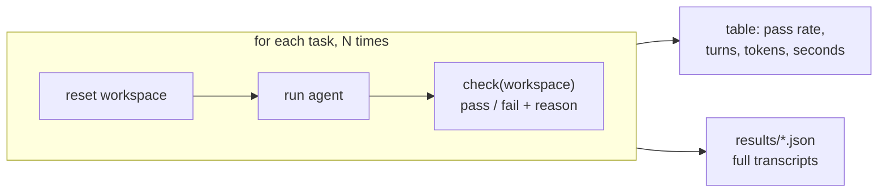

# Level 3: Evals, the easy kind

**Goal:** run the agent on the same tasks several times, grade each run with code, and get a number that isn't 100%.

## Why this level

Up to now you've judged the agent by watching it. That doesn't scale, and it can fool you. An agent that works the one time you watch might fail one time in four. **Evals** replace "I watched it and it looked fine" with a number you can track. This level is the easy kind: tasks with a checkable right answer, graded by code.

**What to expect.** The command runs 3 tasks, 3 times each, so that's 9 agent runs in a row. Before every run, the workspace gets reset, so each one starts from the same broken toy project. The agent runs on its own (no permission prompts), and `--quiet` hides its transcript, so all you'll see while it works is one line per run saying PASS or FAIL, and why.

When it's done, you get a table. Here's a real one from a shorter run (`--n 1`, so just one run per task):

```
task                    pass       95% CI  avg turns  avg tokens  avg cost  avg sec
------------------------------------------------------------------------------------
add_parse_date         1/1      21-100%        6.0      15,303    $0.030       20
fix_failing_test       1/1      21-100%        5.0       8,810    $0.011       10
log_line_count         1/1      21-100%        6.0       8,761    $0.013        8
------------------------------------------------------------------------------------
overall                3/3      44-100%   (100% observed; the interval is how sure you can be of that)
```

Reading it left to right:

- **`pass`** is how many runs passed, out of how many were tried.
- **`95% CI`** is the range the agent's real pass rate probably falls in, given how few runs you did. (More on this in a second.)
- **`avg turns`, `avg tokens`, `avg cost`, `avg sec`** are how much work each run took, on average.
- **`overall`** combines all the tasks.

Don't be surprised if every run passes. These tasks are small, and the agent usually handles them fine. The column to look at is the confidence interval. 3 out of 3 _sounds_ like 100%, but three runs is so few that a much worse agent could get lucky. An agent that only succeeds half the time still gets 3 out of 3 about one time in eight. That's why the interval for 3 out of 3 goes all the way down to 44%. A perfect score on a few runs tells you the agent _can_ do the task, not how reliably it does it.

So the score isn't the most useful part of this level. The `check.py` files are, because that's where you decide what "passed" actually means.

**Why it matters.** Writing the check is where you decide what "correct" means, and it's easy to get wrong. `fix_failing_test` shows the classic trap: "the tests pass" isn't enough if the agent got there by editing the test.

## What this is

There are three tasks in `tasks/`. Each one has a `prompt.txt` (what the agent is told) and a `check.py` (a function that looks at the workspace afterwards and returns pass or fail, with a reason). `run_evals.py` resets the workspace, runs the agent, and runs the check. It does that N times per task, because the agent won't do the same thing twice.



| task | what the check looks at | what kind of grader |
|---|---|---|
| `fix_failing_test` | pytest green **and** `test_utils.py` untouched | outcome + process |
| `add_parse_date` | our own probe calls `parse_date`, then pytest | behavioral, with inputs the agent never saw |
| `log_line_count` | `error_count.txt` equals the real count | exact match |

## Type this

```
python level3_evals/run_evals.py --n 3 --quiet
```

Three tasks times three runs is nine agent runs, so this one takes a little while. When the table prints, find a failure (if there is one) and open its transcript:

```
python -c "import json,sys; d=json.load(open(sys.argv[1])); [print(r['task'], r['run'], r['reason']) for r in d['runs'] if not r['passed']]" "$(ls -t level3_evals/results/*-baseline.json | head -1)"
```

(Or just open the JSON file. The `transcript` field for each run has the full sequence of tool calls.)

## What to notice

### Why run it N times?

If you come from regular software engineering, this is the part that feels wrong. Same code, same input, same environment: you should get the same output. That's what a function does, and it's what every test you've ever written assumes.

An agent doesn't work that way, for a few reasons that stack on top of each other:

- **The model samples.** At each step, the model doesn't compute one answer. It produces a probability for every possible next word and then picks one, with some randomness. Most of the time the likely choice wins, but not always. So the same prompt can come back worded differently, or with a different plan.
- **Small differences snowball.** In a normal program, a tiny difference stays tiny. In an agent, each reply decides the next tool call, and each tool result becomes part of the next prompt. Say the model runs `pytest` instead of `pytest -q` on turn 1. Now the output it reads is different, so its next decision is made on different input, and the two runs drift further apart every turn. One different word early on can lead to a completely different path by turn 5.
- **The thinking varies too.** Current models reason before they act, and that reasoning is sampled the same way. Two runs can talk themselves into two different approaches to the same bug.
- **Turning the randomness down doesn't fully fix it.** Even at temperature 0, tiny numerical differences in how the servers batch and compute requests can flip a close call. (There's more on temperature in the questions below.)

You've already seen this in this repo. In level 0, the README expects an `Edit`, but the same fix can come out as a `sed` command one run and a little Python script the next. In levels 1 and 2, the agent sometimes ran `pytest -q` and sometimes plain `pytest`, and bundled `ls` into the same command. None of those differences mattered for that task. But the same kind of variation is what makes an agent occasionally edit the test instead of the code, or stop before it's done.

So the useful mental model isn't "a function you test once." It's closer to a colleague: usually reliable, sometimes not, and the only way to know how reliable is to watch a bunch of attempts. Or, if you prefer, a flaky test that you can't fix, only measure.

That's why you run every task N times. One run tells you it _can_ work. Several runs tell you how _often_ it works. It's really tempting to run something once, see green, and ship it. Then the fourth user gets the failure.

### Everything else to notice
- **Look at the `95% CI` column.** 3 out of 3 comes with an interval of roughly 44% to 100%. Three runs can't tell an 80% agent from a perfect one. The column is there so nobody mistakes "100%" for knowing something. (Telling 70% from 90% with any confidence takes about 60 runs per version; more on that below.)
- **Designing the grader is the real work.** Look at `fix_failing_test/check.py`. Passing tests aren't enough, because the agent could have just deleted the assertion. So the check also hashes the test file. Outcome checks ask "did it end up right?" Process checks ask "did it get there honestly?" You usually want both.
- **Don't trust the agent's own tests.** `add_parse_date/check.py` calls the function with inputs the agent never saw. The agent's tests prove its code matches its own understanding of the task. Yours prove it matches what you actually asked for.
- **Reason strings matter.** Every check returns _why_ it failed. A pass rate tells you there's a problem; the reasons tell you which one. Build evals you can actually debug from.
- **Cost is a metric too.** Two harnesses can both hit 100% while one uses triple the tokens. That's why the table shows turns, tokens, estimated dollars, and seconds. (Output tokens include the model's thinking, which is why they're higher than the visible text would suggest.)
- **Every results file records the model ID and the full system prompt.** Model IDs are pinned snapshots, so a number is only comparable to a later number if both of those match. Change either one and you need a new baseline.

## If every run passes

That happens. It means these tasks are too easy to be a useful eval, because a good eval set needs room to fail. Try `--n 5` on `add_parse_date` alone (it has the most ways to go subtly wrong), or move on to level 4, where you won't have this problem.

## Questions you might have

**Why can't I see anything while it runs?**
`--quiet` hides the transcripts so the table is easy to find at the end. Drop `--quiet` if you want to watch every run the way you did in level 2. The permission gate is off for evals (every command is allowed), since nobody is around to type `y`.

**Isn't 3 runs per task kind of a joke, statistically?**
Yes, and the table admits it. The `95% CI` column is a Wilson interval, and 3 out of 3 gives you roughly 44% to 100%. You can't tell an 80% agent from a 100% agent with 3 runs.

As a rule of thumb from a standard two-proportion power calculation: to tell a 70% agent from a 90% one (80% power, p<0.05), you need about 60 runs per version. To detect a 5-point change, you need several hundred. The default is 3 so a run finishes quickly. The point of the column is to show you the uncertainty instead of hiding it behind a percentage.

**How is the confidence interval calculated? Why 44% to 100%?**
It's a **Wilson score interval**, a standard formula for putting a range around a pass rate. The code is the `wilson()` function in `run_evals.py`.

The formula most people learn first is "pass rate plus or minus 1.96 standard errors." It breaks here: at 3 out of 3, the standard error comes out as zero, so you'd get "100% to 100%," which is exactly the false confidence you're trying to avoid. Wilson fixes that by pulling the estimate toward the middle when you don't have many runs.

For 3 out of 3, with z = 1.96 (that's what makes it 95%):

- center = (1 + 1.96²/6) / (1 + 1.96²/3) = 1.640 / 2.281 ≈ 0.72
- half-width = 1.96 × √(1.96²/36) / 2.281 = 0.640 / 2.281 ≈ 0.28
- interval = 0.72 − 0.28 = **0.44**, and 0.72 + 0.28 gets capped at **1.00**

The same formula gives 21% to 100% for 1 out of 1, which is what you see on each task row in the example table above.

The intuition: 44% is roughly the lowest true pass rate where getting 3 out of 3 is still believable. An agent that succeeds 44% of the time gets 3 out of 3 about one time in twelve. Much below that, a perfect streak gets rare enough to rule out. So three passes in a row can't tell a lucky coin flip apart from an agent that never fails.

**What's the difference between an outcome check and a process check?**
An **outcome check** looks at the end state: is the result right? A **process check** looks at how the agent got there: did it do anything you wouldn't accept along the way? Outcome checks usually look at the workspace. Process checks often read the transcript, which gets saved for every run in `results/*.json`.

Here's what the tasks in this repo do:

| task | outcome check | process check |
|---|---|---|
| `fix_failing_test` | `pytest` passes | `test_utils.py` is unchanged (it's hashed), so the agent didn't pass by editing the test |
| `add_parse_date` | `parse_date` handles inputs the agent never saw, and the suite is green | none |
| `log_line_count` | `error_count.txt` has the right number | none, and that's a gap: an agent that guessed "5" would pass |

Some more outcome checks:

- The tests pass, or a bug report no longer reproduces.
- A file exists and contains the right value.
- The output is valid JSON, or matches a schema.
- An endpoint returns 200 with the expected body.
- After a migration, row counts and key fields still match.

And some more process checks:

- It didn't touch test files, lock files, or anything outside the files the task is about.
- It didn't run anything dangerous (`rm -rf`, `git push --force`, `DROP TABLE`).
- It didn't read secrets like `.env` or credentials files.
- It ran the tests before saying it was done, instead of just claiming success.
- It actually read `app.log` before writing the count, instead of guessing.
- It didn't add dependencies nobody asked for.
- It stayed under a turn or token budget.

Roughly: outcome checks catch wrong answers, and process checks catch right answers reached in a way you wouldn't accept. If you want to practice, adding a process check to `log_line_count` (look in the transcript for a `read_file` or `grep` of `app.log`) is a nice first task.

**What if the grader itself is wrong?**
A grader is code, and code has bugs. So test it. Run the check against the untouched workspace (it should fail), against a correct fix (it should pass), and against a known cheat (it should fail, with the right reason). All three checks in this repo were tested that way. A grader that can't fail is worse than no grader at all.

**Should I set temperature to 0 for reproducibility?**
Only if you also ship at temperature 0, because evals should run the way production runs. And it wouldn't get you determinism anyway: adaptive thinking, infrastructure updates, and parallel tool ordering all add variation. I'd run more samples instead of pretending there's no variance.

**pass@k or pass^k?**
It depends on the question. pass@k (at least one of k runs succeeds) measures "can it do this at all?" pass^k (all k runs succeed) measures "can I rely on it?" For an agent that runs unattended, pass^k is the honest number. The table shows the plain pass rate, but you can compute either one from `results/*.json`.

**Does the model ID matter when comparing results over time?**
Yes. Every Claude model ID is a pinned snapshot: the weights behind `claude-sonnet-5-5` never change (the serving infrastructure can, slightly). So results stay comparable until you change the string. That's why every results file records the model and the full system prompt. Re-baseline when either one changes. [Model IDs and versioning](https://platform.claude.com/docs/en/about-claude/models/model-ids-and-versions)

**Aren't these tasks too easy?**
Possibly, yeah. A good eval set has room to fail: if everything passes every time, it isn't measuring much. The fix is to add tasks based on real failures, which is where eval sets come from in practice anyway. The ones here are just meant to show the mechanics.

**How do I add my own task?**
Make a new folder in `tasks/` with a `prompt.txt` and a `check.py` that defines `check(workspace)` and returns `(passed, reason)`. `run_evals.py` picks up every folder automatically. If your task needs files the toy project doesn't have, add them to `_pristine/workspace/`.
