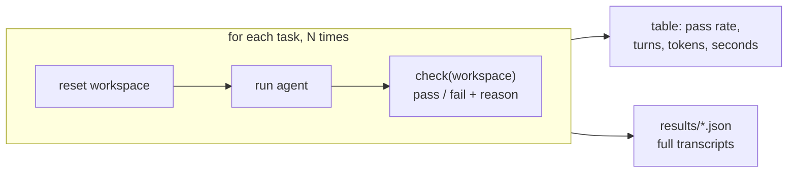

# Level 3: Evals, the easy kind

**Goal:** run the agent on the same tasks several times, grade each run with code, and get a number that isn't 100%.

## Why this level

Up to now you've judged the agent by watching it. That doesn't scale, and it can fool you. An agent that works the one time you watch might fail one time in four. **Evals** replace "I watched it and it looked fine" with a number you can track. This level is the easy kind: tasks with a checkable right answer, graded by code.

**What to expect.** Nine agent runs back to back, with nothing for you to do while they run (`--quiet` hides the transcripts). Then a table with one row per task: how many runs passed, a 95% confidence interval, and the average turns, tokens, cost, and seconds.

On tasks this small, the agent often passes everything. That's still a real result! But 3 out of 3 comes with an interval of roughly 44% to 100%, and an eval set where everything passes isn't telling you much. So I'd spend more of your attention on the `check.py` files than on the score.

**Why it matters.** Writing the check is where you decide what "correct" means, and it's easy to get wrong. `fix_failing_test` shows the classic trap: "the tests pass" isn't enough if the agent got there by editing the test.

## What this is

There are three tasks in `tasks/`. Each one has a `prompt.txt` (what the agent is told) and a `check.py` (a function that looks at the workspace afterwards and returns pass or fail, with a reason). `run_evals.py` resets the workspace, runs the agent, and runs the check. It does that N times per task, because the agent won't do the same thing twice.



| task | what the check looks at | what kind of grader |
|---|---|---|
| `fix_failing_test` | pytest green **and** `test_utils.py` untouched | outcome + process |
| `add_parse_date` | our own probe calls `parse_date`, then pytest | behavioral, with inputs the agent never saw |
| `log_line_count` | `error_count.txt` equals the real count | exact match |

## Type this

```
python level3_evals/run_evals.py --n 3 --quiet
```

Three tasks times three runs is nine agent runs, so this one takes a little while. When the table prints, find a failure (if there is one) and open its transcript:

```
python -c "import json,sys; d=json.load(open(sys.argv[1])); [print(r['task'], r['run'], r['reason']) for r in d['runs'] if not r['passed']]" level3_evals/results/*-baseline.json
```

(Or just open the JSON file. The `transcript` field for each run has the full sequence of tool calls.)

## What to notice

- **Why N times.** One run tells you it _can_ work. Several runs tell you how _often_ it works. It's really tempting to run something once, see green, and ship it. Then the fourth user gets the failure.
- **Look at the `95% CI` column.** 3 out of 3 comes with an interval of roughly 44% to 100%. Three runs can't tell an 80% agent from a perfect one. The column is there so nobody mistakes "100%" for knowing something. (Telling 70% from 90% with any confidence takes about 60 runs per version; more on that below.)
- **Designing the grader is the real work.** Look at `fix_failing_test/check.py`. Passing tests aren't enough, because the agent could have just deleted the assertion. So the check also hashes the test file. Outcome checks ask "did it end up right?" Process checks ask "did it get there honestly?" You usually want both.
- **Don't trust the agent's own tests.** `add_parse_date/check.py` calls the function with inputs the agent never saw. The agent's tests prove its code matches its own understanding of the task. Yours prove it matches what you actually asked for.
- **Reason strings matter.** Every check returns _why_ it failed. A pass rate tells you there's a problem; the reasons tell you which one. Build evals you can actually debug from.
- **Cost is a metric too.** Two harnesses can both hit 100% while one uses triple the tokens. That's why the table shows turns, tokens, estimated dollars, and seconds. (Output tokens include the model's thinking, which is why they're higher than the visible text would suggest.)
- **Every results file records the model ID and the full system prompt.** Model IDs are pinned snapshots, so a number is only comparable to a later number if both of those match. Change either one and you need a new baseline.

## If every run passes

That happens. It means these tasks are too easy to be a useful eval, because a good eval set needs room to fail. Try `--n 5` on `add_parse_date` alone (it has the most ways to go subtly wrong), or move on to level 4, where you won't have this problem.

## Questions you might have

**Why can't I see anything while it runs?**
`--quiet` hides the transcripts so the table is easy to find at the end. Drop `--quiet` if you want to watch every run the way you did in level 2. The permission gate is off for evals (every command is allowed), since nobody is around to type `y`.

**Isn't 3 runs per task kind of a joke, statistically?**
Yes, and the table admits it. The `95% CI` column is a Wilson interval, and 3 out of 3 gives you roughly 44% to 100%. You can't tell an 80% agent from a 100% agent with 3 runs.

As a rule of thumb from a standard two-proportion power calculation: to tell a 70% agent from a 90% one (80% power, p<0.05), you need about 60 runs per version. To detect a 5-point change, you need several hundred. The default is 3 so a run finishes quickly. The point of the column is to show you the uncertainty instead of hiding it behind a percentage.

**What if the grader itself is wrong?**
A grader is code, and code has bugs. So test it. Run the check against the untouched workspace (it should fail), against a correct fix (it should pass), and against a known cheat (it should fail, with the right reason). All three checks in this repo were tested that way. A grader that can't fail is worse than no grader at all.

**Should I set temperature to 0 for reproducibility?**
Only if you also ship at temperature 0, because evals should run the way production runs. And it wouldn't get you determinism anyway: adaptive thinking, infrastructure updates, and parallel tool ordering all add variation. I'd run more samples instead of pretending there's no variance.

**pass@k or pass^k?**
It depends on the question. pass@k (at least one of k runs succeeds) measures "can it do this at all?" pass^k (all k runs succeed) measures "can I rely on it?" For an agent that runs unattended, pass^k is the honest number. The table shows the plain pass rate, but you can compute either one from `results/*.json`.

**Does the model ID matter when comparing results over time?**
Yes. Every Claude model ID is a pinned snapshot: the weights behind `claude-sonnet-5-5` never change (the serving infrastructure can, slightly). So results stay comparable until you change the string. That's why every results file records the model and the full system prompt. Re-baseline when either one changes. [Model IDs and versioning](https://platform.claude.com/docs/en/about-claude/models/model-ids-and-versions)

**Aren't these tasks too easy?**
Possibly, yeah. A good eval set has room to fail: if everything passes every time, it isn't measuring much. The fix is to add tasks based on real failures, which is where eval sets come from in practice anyway. The ones here are just meant to show the mechanics.

**How do I add my own task?**
Make a new folder in `tasks/` with a `prompt.txt` and a `check.py` that defines `check(workspace)` and returns `(passed, reason)`. `run_evals.py` picks up every folder automatically. If your task needs files the toy project doesn't have, add them to `_pristine/workspace/`.
