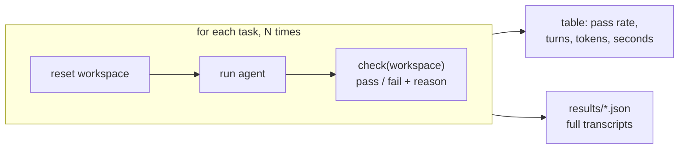

# Level 3: Evals, the easy kind

**Goal:** run the agent on the same tasks several times, grade each run with code, see a number that isn't 100%.

## Why this level

Up to now you've judged the agent by watching it. That doesn't scale, and it can mislead you. An agent that works the one time you watch might fail one time in four. **Evals** replace "I watched it and it looked fine" with a number you can track. This level is the easy kind: tasks that have a checkable right answer, graded by code.

**What to expect.** Nine agent runs one after another, with nothing for you to do while they run (`--quiet` hides the transcripts). Then a table with one row per task: how many runs passed, a 95% confidence interval, and average turns, tokens, cost and seconds. On tasks this small, the agent often passes everything. That's still a real result. 3 out of 3 comes with an interval of roughly 44% to 100%, and an eval set where everything passes isn't telling you much. Spend more of your attention on the `check.py` files than on the score.

**Why it matters.** Writing the check is where you decide what "correct" means, and it's easy to get wrong. `fix_failing_test` shows the classic trap: "the tests pass" isn't enough if the agent got there by editing the test.

## What this is

Three tasks in `tasks/`. Each has a `prompt.txt` (what the agent is told) and a `check.py` (a function that looks at the workspace afterwards and returns pass or fail with a reason). `run_evals.py` resets the workspace, runs the agent, runs the check, and does that N times per task because the agent won't do the same thing twice.



| task | what the check looks at | what kind of grader |
|---|---|---|
| `fix_failing_test` | pytest green **and** `test_utils.py` untouched | outcome + process |
| `add_parse_date` | our own probe calls `parse_date`, then pytest | behavioral, with inputs the agent never saw |
| `log_line_count` | `error_count.txt` equals the real count | exact match |

## Type this

```
python level3_evals/run_evals.py --n 3 --quiet
```

Three tasks times three runs is nine agent runs, so this takes a while. When the table prints, find a failure and open its transcript:

```
python -c "import json,sys; d=json.load(open(sys.argv[1])); [print(r['task'], r['run'], r['reason']) for r in d['runs'] if not r['passed']]" level3_evals/results/*-baseline.json
```

(Or just open the JSON file. The `transcript` field for each run is the full tool-call sequence.)

## What to notice

- **Why N times.** One run tells you it *can* work. Several runs tell you how *often*. Engineers run it once, see green, ship. The fourth user gets the failure.
- **Read the `95% CI` column.** 3/3 comes with an interval of roughly 44% to 100%. Three runs can't tell an 80% agent from a perfect one. The column exists so nobody mistakes "100%" for knowledge. (Telling 70% from 90% with confidence takes about 60 runs per arm; see `FAQ.md`.)
- **Grader design is the real work.** Look at `fix_failing_test/check.py`. Tests passing isn't enough; the agent could have deleted the assertion. The check also hashes the test file. Outcome checks ask "did it end up right?" Process checks ask "did it get there honestly?" You usually want both.
- **Don't trust the agent's own tests.** `add_parse_date/check.py` calls the function with inputs the agent never saw. The agent's tests prove its code matches its understanding. Yours prove it matches the spec.
- **Reason strings matter.** Every check returns *why* it failed. A pass rate tells you there's a problem. The reasons tell you which problem. Build evals you can debug from.
- **Cost is a metric too.** Two harnesses can both hit 100% and one uses triple the tokens. The table shows turns, tokens, estimated dollars and seconds for that reason. (Output tokens include the model's thinking, which is why they're higher than the visible text suggests.)
- **Every results file records the model ID and the full system prompt text.** Model IDs are pinned snapshots, so a number is comparable to a later number only if both of those match. Change either, re-baseline.

## If every run passes

That happens. It means this task is too easy to be a useful eval. A good eval set has headroom. Try `--n 5` on `add_parse_date` alone, which has the most ways to go subtly wrong, or move on to level 4 where you won't have this problem.
