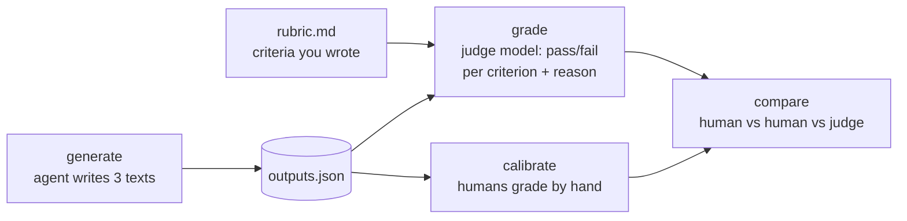

# Level 4: Evals, the hard kind

**Goal:** grade outputs that have no single right answer, without pretending they do.

## Why this level

Most of what agents produce can't be checked with an `assert`: a commit message, an explanation, a README. Teams usually do one of two things with that kind of output. They skip evaluating it, or they ask a model "is this good?" and trust whatever it says. Neither is great.

This level shows the middle path. Write down what good means as pass/fail criteria, let a second model apply them, and then check that model against humans before you rely on it.

**What to expect.** Most of the real work is the first step: adding your own criterion to each of the three rubrics. After that, the agent writes six texts and the judge grades each one twice. With tight pass/fail criteria, the judge mostly agrees with itself. When it doesn't, it's usually on the vaguest criterion, and that's a useful thing to find out.

Then come two demos of what goes wrong without that structure. Asked for a 1-to-10 score instead, the judge will often give the same text different scores in the two rounds (in one test run, a 4 and then a 6 for the same explanation). Asked which of two outputs is better, it gets asked in both orders, because judges can favor whichever one they saw first. That bias only shows up sometimes, and on these tasks it often doesn't.

Finally, you grade the same outputs by hand, and a table shows you where you and the judge agree.

**Why it matters.** You come out of this with a judge you've checked criterion by criterion, instead of one you're assuming works. That's what lets you leave it running on its own in level 5.

## What this is

Three tasks whose output is text: a README, a commit message, and an explanation of a stack trace. No `assert` can grade these. Instead, each task has a `rubric.md` with pass/fail criteria, and `judge.py` asks a second model to apply the rubric. Then `calibrate.py` has you (and ideally someone else) apply the same rubric by hand, and shows where the humans and the judge disagree.



## What's an LLM judge?

An **LLM judge** is just another call to a model, with a different job. Instead of asking it to do the task, you show it someone else's attempt and ask it to grade it.

It's not an agent. There's no loop and no tools here. `judge.py` sends one request and gets one answer back. The request is built from `JUDGE_PROMPT.md`, with three things filled in:

1. **The task** the agent was given (from `prompt.txt`).
2. **The rubric** (the criteria from `rubric.md`).
3. **The agent's output** (its final reply, or the file it wrote).

For `write_readme` there's a fourth thing: **the project itself**, meaning the list of files plus the contents of `utils.py` and `test_utils.py`. Without it, the judge has no way to check whether the README made anything up. (There's more on why in the questions at the end.)

The prompt tells the judge to grade each criterion as pass or fail, to be "strict and literal," and to reply with JSON only, shaped like this:

```
{"grades": [{"criterion": "Body explains WHY the change was needed ...", "pass": true, "reason": "The body says the test expects lowercase slugs."}, ...]}
```

`judge.py` reads that JSON and prints one line per criterion: PASS or FAIL, plus the judge's one-sentence reason. Criteria that are really measurements, like `max_words: 150`, never go to the judge at all. Code checks those (more on why in "What to notice").

The judge is a different, cheaper model from the agent: `JUDGE_MODEL` in `harness/__init__.py`, which defaults to Haiku. There's a reason it's not the same model, and it's in the questions at the end.

**Why use one?** Because nobody wants to read every output by hand every time they change something. A judge can grade hundreds of outputs in minutes, it doesn't get tired or bored, and it applies the same written criteria every time.

**Why not trust it blindly?** Because it's a model, so it has model problems. It can be inconsistent, it can be swayed by length or confident wording, and it can misread a criterion you thought was clear. That's what the rest of this level is about: making the judge's job as narrow as possible, measuring how much it wobbles, and checking it against humans before you rely on it.

## Type this

**The three tasks.** Before you can say what a good answer looks like, you need to know the question. Each task is a folder in `tasks/` with a `prompt.txt` (exactly what the agent is told), a `task.json` (which part of the run gets graded), and a `rubric.md` (what counts as good). All three run on the same toy project as before.

- **`commit_message`.** The agent is told: _"The test suite has one failing test. Fix it, then reply with ONLY a git commit message for the change (subject line, blank line, body). Nothing else in your final reply."_ So it fixes the same `slugify` bug from the earlier levels, and what gets graded is its final reply: the commit message itself. The rubric already checks for a short, imperative subject line ("Fix ...", not "Fixed ..."), a body that explains _why_ the change was needed and not just what changed, and no extra chatter around the message.
- **`explain_trace`.** The workspace has a `trace.txt` with a short Python stack trace: a checkout request crashed with `KeyError: 'shipping_address'` because the `user` dictionary had no shipping address when `build_order` ran, on line 58 of `orders.py`. (Those files don't exist in the workspace. The agent only gets the trace, like you would from an error alert.) The agent is told to explain to a junior engineer who's been on the team for two weeks what went wrong and what to look at first, in under 150 words, without changing any files. Its final reply gets graded. The rubric already checks that it names the real cause, points to a concrete first place to look, pitches it at a junior engineer, and stays under 150 words.
- **`write_readme`.** The agent is told: _"Write a README.md for this project. Someone who has never seen the code should understand what it does and how to run the tests."_ This time what gets graded is the `README.md` file it writes, not its reply. The rubric already checks that the first few lines say what the module is for, that it gives the exact command to run the tests, and that it doesn't make up features or files. One thing to know: the `slugify` bug is still there during this task (nobody asked the agent to fix it), so the README it writes will often mention a failing test or a "known issue."

**First, fill in the rubrics.** Open each `tasks/*/rubric.md`. Each one has three or four criteria already written and one `TODO` line. Decide what _you_ would want from a good commit message (or README, or explanation), and write it in. It takes a couple of minutes, and it's the most important part of the level.

Then:

```
python level4_judge/judge.py generate --n 2 --quiet
python level4_judge/judge.py grade --twice
```

`generate` runs the agent six times (3 tasks x 2) and prints each output. `grade --twice` judges every output twice and flags any criterion where the judge disagreed with itself.

Next, the two demos that make you trust this less, and then more:

```
python level4_judge/judge.py grade --numeric --twice
```

Same outputs, but now the judge gives one 1-to-10 score instead of pass/fail per criterion. Watch the scores wobble between the two rounds. Pass/fail per criterion stays put; a vibes-based score doesn't.

```
python level4_judge/judge.py pairwise
```

This shows the judge both outputs for each task and asks which is better, then swaps the order and asks again. If the answer flips, that's position bias.

Once you've read through all of that (the next section walks through it), the last step is calibration. It gets its own section after that, because it's the most important part of the level.

## Reading the output

**`grade --twice`** prints every criterion with both rounds of grading underneath:

```
  [PASS] Correctly identifies the cause: the user dict has no "shipping_address" key ...
         pass: The output states that line 58 does `user["shipping_address"]` ...
         pass: The output states that build_order runs user["shipping_address"] ...
  [SPLIT] Pitched at a junior engineer: no unexplained jargon, ...   <-- judge disagreed with itself
         pass: The language is plain and not condescending, though terms like "call chain," "500," ...
         fail: The output uses unexplained jargon such as 'a 500' (HTTP status), 'call chain', ...
  [FAIL] max words 150  [checked by code]
         fail: 152 words (checked by code)
```

- **`[PASS]` / `[FAIL]`** means both rounds agreed. **`[SPLIT]`** means they didn't.
- **Look at _which_ criterion splits.** In this run it was "pitched at a junior engineer," in both explanations, and never any of the clear-cut ones. The two rounds noticed the same words ("call chain," "a 500," `.get()`) and just disagreed about whether they count as jargon. That's not really the judge being flaky. It's the criterion being vague. If you replaced it with something like "explains any term a junior engineer might not know, such as HTTP status codes," it would likely stop splitting.
- **`[checked by code]`** lines never went to the judge. That's why both rounds always match.

At the end there's a table:

```
task                criteria passed
------------------------------------
explain_trace r1         4/4
explain_trace r2         2/4
...
overall                 18/20      (90%)
```

The table only counts the **first round**. So a `[SPLIT]` criterion counts as a pass or a fail depending on what round 1 happened to say. In this run, both explanations split on the junior-engineer criterion, but round 1 passed it for the first one and failed it for the second. That's part of why one scored `4/4` and the other `2/4` (the second one also went over the word limit). The second round exists to show you the wobble, not to change the score.

**`grade --numeric --twice`** prints one score per round:

```
  scores: [4, 6]   <-- drifted
    ... runs about 157 words, over the 150-word limit.
```

Two things to notice here. First, the same text got a 4 and a 6, and nothing in the score tells you why. Second, the judge guessed the word count, and got it wrong: code counted 152. In numeric mode, the judge still sees the "under 150 words" in the task, so it tries to count, and that's exactly why the regular `grade` hands counting to code.

You may also see a text that passes every criterion in `grade` but only scores a 5 or 6 here. The score is picking up on something no criterion covers (in one run, a README whose example contradicted its own "known issue" note). That's a hint you might be missing a criterion. It's not a reason to switch to scores, since a score can't tell you _what_ it didn't like.

**`pairwise`** prints both orders for each task:

```
explain_trace
  order (1,2): prefers run 1  Output A names the cause ... whereas Output B runs about 150 words ...
  order (2,1): prefers run 1  ... Output A likely exceeds the 150-word limit, while Output B stays under it.
  consistent
```

The `prefers run N` part is already translated back to run numbers. The reasons aren't, though. In the `(2,1)` line, "Output A" is run 2, because that's the one the judge saw first. So the two reasons above actually agree with each other. If you see `FLIPPED`, the judge preferred whichever output came first (or second) both times, which is position bias. Getting `0 of 3 comparisons flipped` is a normal result too.

## Calibrate: check the rubric against real readers

**Instructions that seem easy to check are often confusing.** This is the part engineers tend to skip, and it's the part that matters most.

When you wrote "pitched at a junior engineer: no unexplained jargon," it probably felt clear. You knew what you meant. But the judge just split on that exact criterion: same output, same words, two different verdicts. And it wasn't being random. Both rounds pointed at the same terms ("call chain," "a 500," `.get()`) and disagreed about whether they count as jargon. Another person reading your rubric could easily do the same thing.

Calibration is how you find that out on purpose, instead of discovering it later when your eval numbers stop making sense. You grade the same outputs the judge graded, using only the rubric's words. Then you line up everyone's answers and look at where they differ. Every disagreement points at a sentence somebody read differently than you meant it.

### Step 1: grade the outputs yourself

```
python level4_judge/calibrate.py grade --name <your name>
```

This shows you each of the six outputs, one at a time: the task the agent was given, the agent's output, and then each criterion from the rubric. For every criterion, type `p` for pass or `f` for fail. It doesn't call the API at all. Your answers are saved to `results/human-<your name>.json`.

A few things that make this work better:

- **Grade what the rubric says, not what you meant.** If a criterion is vague enough that you're unsure, notice that. It's a finding, not a mistake on your part.
- **Don't look at the judge's grades first.** Scroll past them or close that terminal. Once you've seen its answer, it's very hard not to anchor on it.
- **You'll be asked about the `[checked by code]` criteria too.** Count if you want to, or just answer honestly. It's a nice check that the code and you agree on what "150 words" means.

### Step 2: get a second reader

```
python level4_judge/calibrate.py grade --name <second grader>
```

This step is optional, but I'd really recommend it. The best second grader is someone who _didn't_ write the rubric, because all they have is the words. You, on the other hand, also have everything you meant and didn't write down. Have them grade on their own screen, and don't compare notes until both of you are done.

If there's nobody around, you can get a second opinion from a different model instead. Re-run the judge with a different `JUDGE_MODEL`, then compare again, and the `judge` column will show how that model read your rubric:

```
JUDGE_MODEL=claude-sonnet-5-5 python level4_judge/judge.py grade
```

(That overwrites the previous judge grades, so re-run plain `judge.py grade` afterwards if you want the default judge back.)

### Step 3: compare

```
python level4_judge/calibrate.py compare
```

You get one row per criterion per output, with a column for every grader, including the judge. Here's what it looks like from a test run with two graders (trimmed):

```
task / criterion                                              tester1  tester2    judge
-----------------------------------------------------------------------------------------
commit_message r1: Body explains WHY the change was needed (     pass     pass     pass
explain_trace r1: Pitched at a junior engineer: no unexplain     pass     fail     fail  <--
explain_trace r2: max words 150  [checked by code]               pass     pass     fail  <--
write_readme r1: Does not invent features, options, or files     pass     fail     pass  <--
...

agreement (share of criteria where both graders gave the same verdict):
  tester1 vs tester2: 16/20 (80%)
  tester1 vs judge: 18/20 (90%)
  tester2 vs judge: 16/20 (80%)
```

- **`<--`** marks every row where the graders didn't all agree. Those rows are the whole point. Skim past the rest.
- **The agreement lines** tell you how often each pair of graders matched, across every criterion. They're a useful summary, but the individual `<--` rows tell you what to actually fix.
- **The `judge` column** uses the first round from your last `judge.py grade` run, the same as the pass-rate table.

If you change the outputs (by running `generate` again) or edit a rubric, everyone's old grades no longer line up with what's in front of them. `compare` checks for that, skips anyone whose grades are out of date, and tells you who needs to re-grade.

### Step 4: decide what each disagreement means

Every `<--` row falls into one of a few patterns:

| what you see | what it probably means | what to do |
|---|---|---|
| the humans disagree with each other | the criterion is ambiguous | rewrite it until two people would read it the same way |
| the humans agree, the judge doesn't | the judge is misreading it | make the criterion more explicit, add an example, tighten `JUDGE_PROMPT.md`, or try a stronger judge model |
| everyone disagrees with the `[checked by code]` result | your code check measures something different than people expect | fix the check, or rename it so it says what it really measures |
| everyone agrees | the criterion works | you can trust the judge on this one |

Most of the time, the fix is rewriting the criterion. A few moves that tend to help:

- **Name the specifics.** Instead of "no unexplained jargon," try "explains any term a two-week junior might not know (for example HTTP status codes or `.get()`), or avoids using it."
- **Split it.** "No unexplained jargon, no condescension, assumes they know Python basics" is really three criteria. If people disagree on one, you can't tell which part.
- **Make it observable.** "Is clear" is a feeling. "Names the file and line number to look at first" is something two people can check the same way.
- **Add an example of a pass and a fail** right in the rubric line, if the boundary is subtle.

### Step 5: do it again

After you change a criterion, re-run `judge.py grade --twice` and grade by hand again. You're done when the people agree with each other and the judge agrees with the people, on every criterion you plan to let the judge handle alone.

And it's not a one-time thing. New outputs bring new edge cases nobody thought of when the rubric was written. Every time you change the rubric, the agent, or the judge model, it's worth re-checking a sample by hand. A judge you calibrated once, six months ago, against outputs that no longer look like today's, isn't really calibrated anymore.

## What to notice

- **Writing the rubric _is_ the eval.** "Subjective" tasks are mostly objective criteria nobody has written down yet. Once you write "subject line under 72 characters, imperative mood, body says why," there's very little subjectivity left. The model only applies the rubric. Deciding what good means is a human job, and it stays one.
- **Pass/fail per criterion beats a score.** A 7/10 doesn't mean much, and it moves between runs. "Fails criterion 2: the body doesn't explain why" is something you can act on, and you'll get the same answer next time. The `--numeric` demo shows you this.
- **If you can count it, let code count it.** The `explain_trace` rubric has `max_words: 150`, which `judge.py` checks in Python and labels `[checked by code]`. Models are bad at counting. A word limit, a line count, "contains a code block," "is valid JSON": all of that belongs in code. Most real rubrics are a mix of code checks and judgment calls, and the judge only sees the judgment calls. (If you want to watch the judge guess, change that line to "Under 150 words" and run `grade --twice`.)
- **The judge is a model, so it has model problems.** Position bias, verbosity bias (longer looks better), and self-preference (a model likes its own style). What helps: pass/fail against a rubric instead of head-to-head comparisons, checking both orders if you do compare, and using a different model as the judge than the one being graded. (`JUDGE_MODEL` and `AGENT_MODEL` in `harness/__init__.py` are different for exactly this reason.)
- **Calibration is how you earn the right to automate.** Without it, you're trusting that everyone reads your rubric the way you meant it, and the judge has already shown you they don't. The section above walks through how to check.
- **`JUDGE_PROMPT.md` is worth reading.** It says "be strict and literal" and "do not reward effort or length." Those lines are there because without them, the judge grades like a really nice teacher.

## If the judge agrees with itself every time

Good! Pass/fail against a tight rubric _should_ be stable. The `--numeric` and `pairwise` demos are there to show you what instability looks like. If pairwise doesn't flip either, the two outputs were probably pretty different in quality, which is fine. Position bias shows up when they're close.

## Questions you might have

**You're using a model to grade a model. Why would I trust that?**
You shouldn't, until you've checked it. That's what `calibrate.py` is for. You (and ideally another person) grade the same outputs against the same rubric, then compare against the judge. Where the humans agree and the judge doesn't, fix the judge prompt. Where the humans disagree, fix the rubric. Where everyone agrees, you can let the judge handle that criterion on its own. Trust gets earned one criterion at a time.

**Why pass/fail per criterion instead of a score out of 10?**
A 7/10 is unstable (run `grade --numeric --twice` and watch it move), hard to interpret (7 out of what, exactly?), and doesn't tell you what to do. "Fails criterion 2: the body doesn't say why" is stable, clear, and tells you what to fix. Break the vague judgment into specific yes/no questions and there's very little subjectivity left.

**Why is the word count checked by code?**
Because language models can't count reliably. Any criterion that's really a measurement (length, line count, whether a specific string appears, valid JSON) belongs in code. The `max_words:` syntax in the rubric sends those to code and only sends the judgment calls to the model.

**Why is the judge a different model from the agent?**
Models tend to prefer their own style (self-preference bias), and using a different model reduces that. The tradeoff is that the judge has to be capable enough to apply the rubric. Haiku is fine for tight pass/fail criteria on short outputs. For subtler judgments, I'd use a stronger judge and accept the extra cost. Both models are set in `harness/__init__.py`.

**What's position bias, exactly?**
Ask a judge "which is better, A or B?" and it can lean toward one position no matter what's in it. `pairwise` asks in both orders, and if the preference flips, that's the bias. The fixes: grade each output against the rubric on its own (which is what `grade` does), or if you really need to compare, ask in both orders and only count verdicts that agree.

**Any other judge biases I should know about?**
Verbosity (longer looks better), confidence (sounding sure looks correct), and leniency (the really-nice-teacher problem). None of these go away completely. You measure them and correct for them.

**Why does the judge get to see the project files for `write_readme`?**
Because a judge only knows what's in its prompt. One of the `write_readme` criteria is "does not invent features, options, or files that don't exist in the project." Originally, the judge only got the README, so it had no idea which files existed. In test runs, it passed that criterion every single time while saying things like "I cannot verify the referenced files." Once it even pointed out that the README contradicted itself, and passed it anyway.

A check that can't fail is worse than no check, so now `task.json` for `write_readme` has a `context_files` list. `judge.py` adds those files, plus a list of everything in the project, to the judge's prompt. With that, a README that mentions a made-up `config.yaml` or a `--strict` flag fails with a reason naming both.

The general lesson: before you hand a criterion to a judge, ask what it would need to see to grade it. If the answer isn't in the prompt, either add it or move that criterion to a code check.

**What do `judge error`, `n/a`, or "no verdict" mean in the output?**
The judge didn't return a usable answer for that one (usually malformed JSON). The script tries to recover what it can, and if it can't, it says so and leaves that comparison out of the totals instead of guessing.

**Who writes the rubric?**
You do. This is the part that can't be automated, and it's also the part that's easiest to skip. Deciding that "a good commit message explains why" is a product decision, and the model only applies it. Keep the rubric versioned with the results (each grade in `results/` records the criterion text it was graded against), because changing a criterion changes what the number means.
