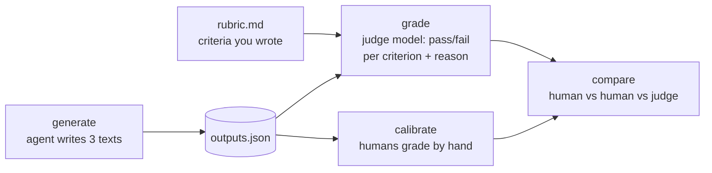

# Level 4: Evals, the hard kind

**Goal:** grade outputs that have no right answer, without pretending they do.

## What this is

Three tasks whose output is text: a README, a commit message, an explanation of a stack trace. No `assert` can grade these. Instead each task has a `rubric.md` with pass/fail criteria, and `judge.py` asks a second model to apply the rubric. Then `calibrate.py` has you (and ideally a second person) apply the same rubric by hand and shows where the humans and the judge disagree.



## Type this

**First, fill in the rubrics.** Open each `tasks/*/rubric.md`. Each has three or four criteria pre-written and one `TODO` line. Decide what *you* would want from a good commit message (or README, or explanation), and write it in. Two minutes, and it's the most important two minutes of the level.

Then:

```
python level4_judge/judge.py generate --n 2 --quiet
python level4_judge/judge.py grade --twice
```

`generate` runs the agent six times (3 tasks x 2) and prints each output. `grade --twice` judges every output twice and flags any criterion where the judge disagreed with itself.

Then the two demos that make engineers trust this less, and then more:

```
python level4_judge/judge.py grade --numeric --twice
```

Same outputs, but now the judge gives one 1-to-10 score instead of pass/fail per criterion. Watch the scores drift between the two rounds. Pass/fail per criterion is stable; a vibe score is not.

```
python level4_judge/judge.py pairwise
```

Shows the judge both outputs for each task and asks which is better, then swaps the order and asks again. When the answer flips, that's position bias.

**Then calibrate.** Grade the same outputs by hand. If you can get a second person to grade too, do it on separate screens without conferring:

```
python level4_judge/calibrate.py grade --name <your name>
python level4_judge/calibrate.py grade --name <second grader>   # optional
python level4_judge/calibrate.py compare
```

## What to notice

- **Writing the rubric is the eval.** "Subjective" tasks are mostly objective criteria you haven't written down yet. Once you write "subject line under 72 chars, imperative mood, body says why," there is very little subjective residue. The model only applies the rubric; deciding what good means is a human job and stays one.
- **Pass/fail per criterion beats a score.** A 7/10 means nothing and moves between runs. "Fails criterion 2: body doesn't explain why" is actionable and reproducible. The `--numeric` demo shows this.
- **Anything you can count, code counts.** The `explain_trace` rubric has `max_words: 150`, which `judge.py` checks in Python and labels `[checked by code]`. Models are bad at counting; a word limit, a line count, "contains a code block," "is valid JSON" all belong in code. A rubric is normally a mix of code checks and judgment calls, and the judge only sees the second kind. (If you want to watch the judge guess, change that line to the prose "Under 150 words" and run `grade --twice`.)
- **The judge is a model, so it has model problems.** Position bias, verbosity bias (longer looks better), self-preference (a model likes its own style). Mitigations: pass/fail against a rubric instead of pairwise, run both orders if you must compare, and use a different model as judge than the one being graded. (`JUDGE_MODEL` and `AGENT_MODEL` in `harness/__init__.py` are different for that reason.)
- **Calibration is how you earn the right to automate.** Read the `compare` table. Where two humans disagree, the rubric is ambiguous; fix the words. Where the humans agree and the judge doesn't, fix the judge prompt. Where everyone agrees, you can let the judge run unattended on that criterion. Nobody skips this step and ends up with a judge they trust.
- **`JUDGE_PROMPT.md` is worth reading.** It says "be strict and literal" and "do not reward effort or length." Those lines exist because without them the judge grades like a kind teacher.

## If the judge agrees with itself every time

Good: pass/fail against a tight rubric *should* be stable. The `--numeric` and `pairwise` demos are there to show what instability looks like. If pairwise also doesn't flip, the two outputs were probably very different in quality; that's fine, position bias shows up when they're close.
