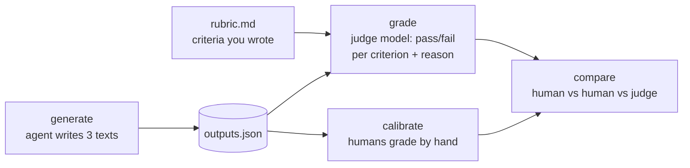

# Level 4: Evals, the hard kind

**Goal:** grade outputs that have no single right answer, without pretending they do.

## Why this level

Most of what agents produce can't be checked with an `assert`: a commit message, an explanation, a README. Teams usually do one of two things with that kind of output. They skip evaluating it, or they ask a model "is this good?" and trust whatever it says. Neither is great.

This level shows the middle path. Write down what good means as pass/fail criteria, let a second model apply them, and then check that model against humans before you rely on it.

**What to expect.** Most of the real work is the first step: adding your own criterion to each of the three rubrics. After that, the agent writes six texts and the judge grades each one twice. With tight pass/fail criteria, the judge usually agrees with itself.

Then come two demos of what goes wrong without that structure. Asked for a 1-to-10 score instead, the judge will often give the same text different scores in the two rounds (8 one time, 7 the next). Asked which of two outputs is better, it gets asked in both orders, because judges can favor whichever one they saw first. Sometimes that shows up and sometimes it doesn't.

Finally, you grade the same outputs by hand, and a table shows you where you and the judge agree.

**Why it matters.** You come out of this with a judge you've checked criterion by criterion, instead of one you're assuming works. That's what lets you leave it running on its own in level 5.

## What this is

Three tasks whose output is text: a README, a commit message, and an explanation of a stack trace. No `assert` can grade these. Instead, each task has a `rubric.md` with pass/fail criteria, and `judge.py` asks a second model to apply the rubric. Then `calibrate.py` has you (and ideally someone else) apply the same rubric by hand, and shows where the humans and the judge disagree.



## Type this

**The three tasks.** Before you can say what a good answer looks like, you need to know the question. Each task is a folder in `tasks/` with a `prompt.txt` (exactly what the agent is told), a `task.json` (which part of the run gets graded), and a `rubric.md` (what counts as good). All three run on the same toy project as before.

- **`commit_message`.** The agent is told: _"The test suite has one failing test. Fix it, then reply with ONLY a git commit message for the change (subject line, blank line, body). Nothing else in your final reply."_ So it fixes the same `slugify` bug from the earlier levels, and what gets graded is its final reply: the commit message itself. The rubric already checks for a short, imperative subject line ("Fix ...", not "Fixed ..."), a body that explains _why_ the change was needed and not just what changed, and no extra chatter around the message.
- **`explain_trace`.** The workspace has a `trace.txt` with a short Python stack trace: a checkout request crashed with `KeyError: 'shipping_address'` because the `user` dictionary had no shipping address when `build_order` ran, on line 58 of `orders.py`. (Those files don't exist in the workspace. The agent only gets the trace, like you would from an error alert.) The agent is told to explain to a junior engineer who's been on the team for two weeks what went wrong and what to look at first, in under 150 words, without changing any files. Its final reply gets graded. The rubric already checks that it names the real cause, points to a concrete first place to look, pitches it at a junior engineer, and stays under 150 words.
- **`write_readme`.** The agent is told: _"Write a README.md for this project. Someone who has never seen the code should understand what it does and how to run the tests."_ This time what gets graded is the `README.md` file it writes, not its reply. The rubric already checks that the first few lines say what the module is for, that it gives the exact command to run the tests, and that it doesn't make up features or files.

**First, fill in the rubrics.** Open each `tasks/*/rubric.md`. Each one has three or four criteria already written and one `TODO` line. Decide what _you_ would want from a good commit message (or README, or explanation), and write it in. It takes a couple of minutes, and it's the most important part of the level.

Then:

```
python level4_judge/judge.py generate --n 2 --quiet
python level4_judge/judge.py grade --twice
```

`generate` runs the agent six times (3 tasks x 2) and prints each output. `grade --twice` judges every output twice and flags any criterion where the judge disagreed with itself.

Next, the two demos that make you trust this less, and then more:

```
python level4_judge/judge.py grade --numeric --twice
```

Same outputs, but now the judge gives one 1-to-10 score instead of pass/fail per criterion. Watch the scores wobble between the two rounds. Pass/fail per criterion stays put; a vibes-based score doesn't.

```
python level4_judge/judge.py pairwise
```

This shows the judge both outputs for each task and asks which is better, then swaps the order and asks again. If the answer flips, that's position bias.

**Then calibrate.** Grade the same outputs by hand. If you can get a second person to grade too, I'd recommend it. Do it on separate screens and don't compare notes:

```
python level4_judge/calibrate.py grade --name <your name>
python level4_judge/calibrate.py grade --name <second grader>   # optional
python level4_judge/calibrate.py compare
```

## What to notice

- **Writing the rubric _is_ the eval.** "Subjective" tasks are mostly objective criteria nobody has written down yet. Once you write "subject line under 72 characters, imperative mood, body says why," there's very little subjectivity left. The model only applies the rubric. Deciding what good means is a human job, and it stays one.
- **Pass/fail per criterion beats a score.** A 7/10 doesn't mean much, and it moves between runs. "Fails criterion 2: the body doesn't explain why" is something you can act on, and you'll get the same answer next time. The `--numeric` demo shows you this.
- **If you can count it, let code count it.** The `explain_trace` rubric has `max_words: 150`, which `judge.py` checks in Python and labels `[checked by code]`. Models are bad at counting. A word limit, a line count, "contains a code block," "is valid JSON": all of that belongs in code. Most real rubrics are a mix of code checks and judgment calls, and the judge only sees the judgment calls. (If you want to watch the judge guess, change that line to "Under 150 words" and run `grade --twice`.)
- **The judge is a model, so it has model problems.** Position bias, verbosity bias (longer looks better), and self-preference (a model likes its own style). What helps: pass/fail against a rubric instead of head-to-head comparisons, checking both orders if you do compare, and using a different model as the judge than the one being graded. (`JUDGE_MODEL` and `AGENT_MODEL` in `harness/__init__.py` are different for exactly this reason.)
- **Calibration is how you earn the right to automate.** Look at the `compare` table. Where two humans disagree, the rubric is ambiguous, so fix the wording. Where the humans agree and the judge doesn't, fix the judge prompt. Where everyone agrees, you can let the judge handle that criterion on its own. If you skip this step, you end up with a judge you can't really trust.
- **`JUDGE_PROMPT.md` is worth reading.** It says "be strict and literal" and "do not reward effort or length." Those lines are there because without them, the judge grades like a really nice teacher.

## If the judge agrees with itself every time

Good! Pass/fail against a tight rubric _should_ be stable. The `--numeric` and `pairwise` demos are there to show you what instability looks like. If pairwise doesn't flip either, the two outputs were probably pretty different in quality, which is fine. Position bias shows up when they're close.

## Questions you might have

**You're using a model to grade a model. Why would I trust that?**
You shouldn't, until you've checked it. That's what `calibrate.py` is for. You (and ideally another person) grade the same outputs against the same rubric, then compare against the judge. Where the humans agree and the judge doesn't, fix the judge prompt. Where the humans disagree, fix the rubric. Where everyone agrees, you can let the judge handle that criterion on its own. Trust gets earned one criterion at a time.

**Why pass/fail per criterion instead of a score out of 10?**
A 7/10 is unstable (run `grade --numeric --twice` and watch it move), hard to interpret (7 out of what, exactly?), and doesn't tell you what to do. "Fails criterion 2: the body doesn't say why" is stable, clear, and tells you what to fix. Break the vague judgment into specific yes/no questions and there's very little subjectivity left.

**Why is the word count checked by code?**
Because language models can't count reliably. Any criterion that's really a measurement (length, line count, whether a specific string appears, valid JSON) belongs in code. The `max_words:` syntax in the rubric sends those to code and only sends the judgment calls to the model.

**Why is the judge a different model from the agent?**
Models tend to prefer their own style (self-preference bias), and using a different model reduces that. The tradeoff is that the judge has to be capable enough to apply the rubric. Haiku is fine for tight pass/fail criteria on short outputs. For subtler judgments, I'd use a stronger judge and accept the extra cost. Both models are set in `harness/__init__.py`.

**What's position bias, exactly?**
Ask a judge "which is better, A or B?" and it can lean toward one position no matter what's in it. `pairwise` asks in both orders, and if the preference flips, that's the bias. The fixes: grade each output against the rubric on its own (which is what `grade` does), or if you really need to compare, ask in both orders and only count verdicts that agree.

**Any other judge biases I should know about?**
Verbosity (longer looks better), confidence (sounding sure looks correct), and leniency (the really-nice-teacher problem). None of these go away completely. You measure them and correct for them.

**What do `judge error`, `n/a`, or "no verdict" mean in the output?**
The judge didn't return a usable answer for that one (usually malformed JSON). The script tries to recover what it can, and if it can't, it says so and leaves that comparison out of the totals instead of guessing.

**Who writes the rubric?**
You do. This is the part that can't be automated, and it's also the part that's easiest to skip. Deciding that "a good commit message explains why" is a product decision, and the model only applies it. Keep the rubric versioned with the results (each grade in `results/` records the criterion text it was graded against), because changing a criterion changes what the number means.
