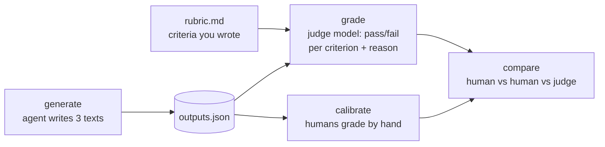

# Level 4: Evals, the hard kind

**Goal:** grade outputs that have no single right answer, without pretending they do.

## Why this level

Most of what agents produce can't be checked with an `assert`: a commit message, an explanation, a README. Teams usually do one of two things with that kind of output. They skip evaluating it, or they ask a model "is this good?" and trust whatever it says. Neither is great.

This level shows the middle path. Write down what good means as pass/fail criteria, let a second model apply them, and then check that model against humans before you rely on it.

**What to expect.** Most of the real work is the first step: adding your own criterion to each of the three rubrics. After that, the agent writes six texts and the judge grades each one twice. With tight pass/fail criteria, the judge usually agrees with itself.

Then come two demos of what goes wrong without that structure. Asked for a 1-to-10 score instead, the judge will often give the same text different scores in the two rounds (8 one time, 7 the next). Asked which of two outputs is better, it gets asked in both orders, because judges can favor whichever one they saw first. Sometimes that shows up and sometimes it doesn't.

Finally, you grade the same outputs by hand, and a table shows you where you and the judge agree.

**Why it matters.** You come out of this with a judge you've checked criterion by criterion, instead of one you're assuming works. That's what lets you leave it running on its own in level 5.

## What this is

Three tasks whose output is text: a README, a commit message, and an explanation of a stack trace. No `assert` can grade these. Instead, each task has a `rubric.md` with pass/fail criteria, and `judge.py` asks a second model to apply the rubric. Then `calibrate.py` has you (and ideally someone else) apply the same rubric by hand, and shows where the humans and the judge disagree.



## Type this

**First, fill in the rubrics.** Open each `tasks/*/rubric.md`. Each one has three or four criteria already written and one `TODO` line. Decide what _you_ would want from a good commit message (or README, or explanation), and write it in. It takes a couple of minutes, and it's the most important part of the level.

Then:

```
python level4_judge/judge.py generate --n 2 --quiet
python level4_judge/judge.py grade --twice
```

`generate` runs the agent six times (3 tasks x 2) and prints each output. `grade --twice` judges every output twice and flags any criterion where the judge disagreed with itself.

Next, the two demos that make you trust this less, and then more:

```
python level4_judge/judge.py grade --numeric --twice
```

Same outputs, but now the judge gives one 1-to-10 score instead of pass/fail per criterion. Watch the scores wobble between the two rounds. Pass/fail per criterion stays put; a vibes-based score doesn't.

```
python level4_judge/judge.py pairwise
```

This shows the judge both outputs for each task and asks which is better, then swaps the order and asks again. If the answer flips, that's position bias.

**Then calibrate.** Grade the same outputs by hand. If you can get a second person to grade too, I'd recommend it. Do it on separate screens and don't compare notes:

```
python level4_judge/calibrate.py grade --name <your name>
python level4_judge/calibrate.py grade --name <second grader>   # optional
python level4_judge/calibrate.py compare
```

## What to notice

- **Writing the rubric _is_ the eval.** "Subjective" tasks are mostly objective criteria nobody has written down yet. Once you write "subject line under 72 characters, imperative mood, body says why," there's very little subjectivity left. The model only applies the rubric. Deciding what good means is a human job, and it stays one.
- **Pass/fail per criterion beats a score.** A 7/10 doesn't mean much, and it moves between runs. "Fails criterion 2: the body doesn't explain why" is something you can act on, and you'll get the same answer next time. The `--numeric` demo shows you this.
- **If you can count it, let code count it.** The `explain_trace` rubric has `max_words: 150`, which `judge.py` checks in Python and labels `[checked by code]`. Models are bad at counting. A word limit, a line count, "contains a code block," "is valid JSON": all of that belongs in code. Most real rubrics are a mix of code checks and judgment calls, and the judge only sees the judgment calls. (If you want to watch the judge guess, change that line to "Under 150 words" and run `grade --twice`.)
- **The judge is a model, so it has model problems.** Position bias, verbosity bias (longer looks better), and self-preference (a model likes its own style). What helps: pass/fail against a rubric instead of head-to-head comparisons, checking both orders if you do compare, and using a different model as the judge than the one being graded. (`JUDGE_MODEL` and `AGENT_MODEL` in `harness/__init__.py` are different for exactly this reason.)
- **Calibration is how you earn the right to automate.** Look at the `compare` table. Where two humans disagree, the rubric is ambiguous, so fix the wording. Where the humans agree and the judge doesn't, fix the judge prompt. Where everyone agrees, you can let the judge handle that criterion on its own. If you skip this step, you end up with a judge you can't really trust.
- **`JUDGE_PROMPT.md` is worth reading.** It says "be strict and literal" and "do not reward effort or length." Those lines are there because without them, the judge grades like a really nice teacher.

## If the judge agrees with itself every time

Good! Pass/fail against a tight rubric _should_ be stable. The `--numeric` and `pairwise` demos are there to show you what instability looks like. If pairwise doesn't flip either, the two outputs were probably pretty different in quality, which is fine. Position bias shows up when they're close.
