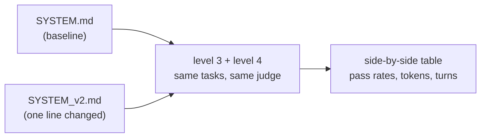

# Level 5: Change one thing, measure everything

**Goal:** the loop engineers should be in. Edit the harness, re-run the evals, read the diff.

## What this is

`run_all.py` runs the level 3 tasks and the level 4 tasks against two system prompts and prints the columns side by side. The loop, tools, turn cap and judge are identical between A and B. Only the words in the system prompt change.



## Type this

Make the variant. Pick one line you think would make the agent better, and add it:

```
cp harness/SYSTEM.md harness/SYSTEM_v2.md
```

Good candidates, pick one:

- `Always run the existing tests before changing any code, and again after.`
- `Never modify test files. If a test looks wrong, say so instead of changing it.`
- `Before writing any file, explain your plan in one sentence.`
- `Be concise. Keep any prose you write under 100 words.` (watch what this does to the README task)

Then:

```
python level5_ab/run_all.py --n 2
```

That's 2 runs x 6 tasks x 2 variants = 24 agent runs plus 12 judge calls, so this is the longest run in the repo. `--skip-level4` halves it.

## What to notice

- **This is why you wrote the evals.** Without them, "I added a line and it seemed better" is the whole story. With them, you can say B passed 11 of 12 where A passed 9, used 20% more tokens, and got worse on the README task. You can't argue with the table; you can only argue about what to measure.
- **Prompt changes have side effects.** The "be concise" line probably helps the commit message and hurts the README. Every change to a shared system prompt is a change to every task it touches. Mixed eval sets catch that; a single happy-path test doesn't.
- **Noise is real at this sample size.** 2 of 2 versus 1 of 2 is not a result. The fix is cheap: run `--n 5` overnight. Evals are the thing you can afford to run a hundred times when a human reviewer can't.
- **This is also how you'd compare models.** Set `AGENT_MODEL` in `.env`, re-run. Same table, different question. Everyone wants to know "is the new model better for my task." This is the only honest way to find out.

## Close the loop

Pull up `level0_watch/README.md` one last time. Everything in this repo fits in that one diagram plus a box around it. Claude Code is that box with a lot of good engineering inside. The evals are how you find out whether your box is any good.
