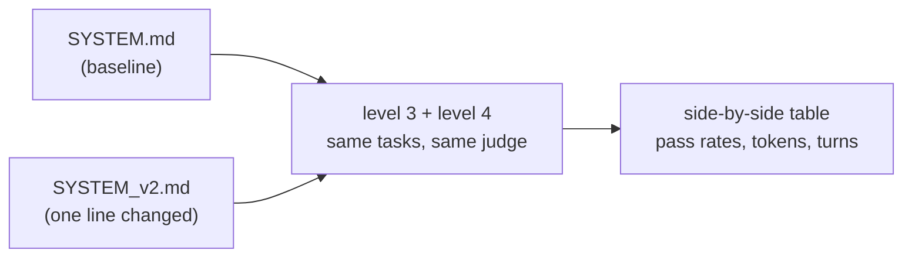

# Level 5: Change one thing, measure everything

**Goal:** get into the loop you'd actually use day to day. Edit the harness, re-run the evals, read the difference.

## Why this level

Everything so far has been building up to the question you'll ask most often: I changed something, so is it better? Without evals, people try a prompt tweak on one example and go with their gut. Here you change one line of the system prompt and re-run every eval from levels 3 and 4 against both versions, side by side.

**What to expect.** You copy `SYSTEM.md`, add one line, and start the run. This is the longest run in the repo, 24 agent runs plus the judge calls, with nothing for you to do until it finishes. At the end you get one table: each task with A's and B's pass counts, tokens, and turns.

With only 2 runs per task, most of the differences will be noise. In one test run, B dropped one criterion on one task and used more tokens on another, and neither meant anything at that sample size. The goal here isn't to crown a winner. It's to get comfortable with the workflow, and to see for yourself how little a small sample can tell you.

**Why it matters.** Edit, re-run, read the difference: that's how you improve an agent without fooling yourself. And the exact same loop answers "is the new model better for my task?" Just change the model instead of the prompt and run it again.

## What this is

`run_all.py` runs the level 3 tasks and the level 4 tasks against two system prompts and prints the results side by side. The loop, tools, turn cap, and judge are identical between A and B. Only the words in the system prompt change.



## Type this

Make the variant. Pick one line you think would make the agent better, and add it:

```
cp harness/SYSTEM.md harness/SYSTEM_v2.md
```

Some good candidates (pick one):

- `Always run the existing tests before changing any code, and again after.`
- `Never modify test files. If a test looks wrong, say so instead of changing it.`
- `Before writing any file, explain your plan in one sentence.`
- `Be concise. Keep any prose you write under 100 words.` (watch what this one does to the README task)

Then:

```
python level5_ab/run_all.py --n 2
```

That's 2 runs x 6 tasks x 2 versions = 24 agent runs, plus 12 judge calls. If you want it faster, `--skip-level4` cuts it in half.

## What to notice

- **This is why you wrote the evals.** Without them, "I added a line and it seemed better" is the whole story. With them, you can say B passed 11 of 12 where A passed 9, used 20% more tokens, and got worse on the README task. You can't really argue with the table; you can only argue about what to measure.
- **Prompt changes have side effects.** The "be concise" line probably helps the commit message and hurts the README. Every change to a shared system prompt is a change to every task it touches. A mixed eval set catches that. A single happy-path test doesn't.
- **At this sample size, noise is real.** 2 out of 2 versus 1 out of 2 is not a result. The fix is cheap, though: run `--n 5` overnight. Evals are something you can afford to run a hundred times, which you definitely can't say about a human reviewer.
- **This is also how you'd compare models.** Set `AGENT_MODEL` in `.env` and re-run. Same table, different question. Everyone wants to know "is the new model better for my task?", and this is the only honest way I know to find out.

## What this repo didn't cover

To be clear about what you just did: you built one small agent, with three tools, on a toy project, and measured it with six tasks. That's enough to see how all the pieces fit together. It's nowhere near the whole field, and I'd hate for anyone to walk away thinking it was. Here's some of what we skipped, roughly in the order you'd probably run into it:

- **Prompt engineering.** Our system prompt is six lines, and we changed one of them. Real agents have long, carefully tested prompts: how to plan, when to ask for help, what to do when stuck, examples of good and bad behavior. Tool descriptions are prompts too, and they're often where the biggest wins are.
- **Better tools.** Three generic tools is the bare minimum. Claude Code has a dozen purpose-built ones (`Edit`, `Grep`, `Glob`, and so on), and designing tools the model uses reliably is a big part of building a good agent.
- **More complex agents.** Ours is one loop that runs until it's done. Real systems add planning steps, subagents that handle part of a task with their own context, multiple agents working together, memory that lasts across sessions, and context management for tasks too long to fit in one conversation.
- **Retrieval (RAG).** Our agent can see every file because there are only five. On a real codebase or a pile of documentation, the agent has to _find_ the right information first, through search or embeddings or both. Retrieval is its own system with its own failure modes, and you'd evaluate it separately: did it find the right thing, before you even ask whether the answer was right.
- **Security.** We mostly ignored it, and level 2 admitted that the sandbox is basically decorative. Real agents need real isolation (containers, limited permissions, no access to secrets they don't need), protection against prompt injection from files and web pages the agent reads, and limits on what any single action can do. An agent with a shell is a security problem first and a productivity tool second.
- **Much bigger evals.** Six tasks with 2 or 3 runs each is a demo. Real eval sets have hundreds of tasks, many of them collected from real failures, with enough runs to say something statistically. They also evaluate the whole path an agent took (did it take a sensible route, not just did it end up right), run in CI on every change, and track cost and speed alongside quality.
- **Evals in production.** Everything here runs offline, on tasks you wrote. Once real people use an agent, you also need monitoring, logging and tracing, a way to collect failures and turn them into new eval tasks, and human review of a sample of real outputs. The level 4 calibration habit never really ends.
- **Cost and speed.** We looked at token counts, but didn't optimize them. In practice there's a lot to do: caching, batching, using a smaller model for easy steps, and deciding how much thinking each step actually needs.

None of this changes the core idea, though. Every one of those is either something inside the loop, something in the box around it, or a way of measuring whether the box is any good. That's still the map.

## Close the loop

Pull up `level0_watch/README.md` one last time. Everything in this repo fits in that one diagram, plus a box around it. Claude Code is that box with a lot of good engineering inside, and evals are how you find out whether your box is any good.

## Questions you might have

**I added "never modify test files" to the prompt and the test-editing failure went away. Didn't I just overfit to the eval?**
Kind of, and that's fine when the eval captures behavior you actually want. The real danger is the bigger version of this: tuning the prompt until the six tasks in this repo pass and then deciding the agent is good. Those six tasks are your eval set, not the world. Keep some tasks held back, add new ones from real failures, and treat a change that helps one task and hurts another as useful information, not noise.

**B scored 5/6 and A scored 4/6. Is B better?**
Not on that evidence. With 2 runs per task you've learned almost nothing about the pass rates, but quite a lot about how things fail (so read the reasons). The honest conclusion is "B looks promising, let's run 20 more," not "B is better."

**Why are the level 4 rows counted in criteria instead of runs?**
Because each text output gets graded on several criteria. The number on the right is criteria times runs: `commit_message` has three criteria, so with `--n 2` it's out of 6, and one failed criterion in one run shows up as `5/6`. It's a finer-grained number than pass/fail per run.

**How would this run in CI?**
Same scripts, either on a schedule or on every change to `SYSTEM.md`. Store the results in the repo so the diffs are easy to review, and fail the build on a regression bigger than the noise you've measured. For runs that don't need to be fast, the Message Batches API is 50% off. You can also run things in parallel with a thread pool, as long as you stay within your rate limits.

**Can I compare models the same way?**
Yes. Set `AGENT_MODEL` in `.env`, re-run, and compare the tables. That's the honest answer to "is the new model better for my task?", and honestly it's the main reason to have an eval set at all.
