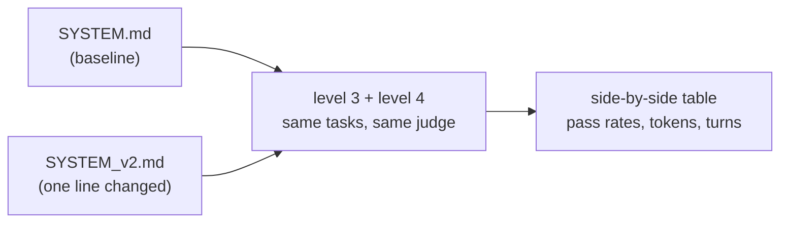

# Level 5: Change one thing, measure everything

**Goal:** get into the loop you'd actually use day to day. Edit the harness, re-run the evals, read the difference.

## Why this level

Everything so far has been building up to the question you'll ask most often: I changed something, so is it better? Without evals, people try a prompt tweak on one example and go with their gut. Here you change one line of the system prompt and re-run every eval from levels 3 and 4 against both versions, side by side.

**What to expect.** You copy `SYSTEM.md`, add one line, and start the run. This is the longest run in the repo, 24 agent runs plus the judge calls, with nothing for you to do until it finishes. At the end you get one table: each task with A's and B's pass counts, tokens, and turns.

With only 2 runs per task, most of the differences will be noise. In one test run, B dropped one criterion on one task and used more tokens on another, and neither meant anything at that sample size. The goal here isn't to crown a winner. It's to get comfortable with the workflow, and to see for yourself how little a small sample can tell you.

**Why it matters.** Edit, re-run, read the difference: that's how you improve an agent without fooling yourself. And the exact same loop answers "is the new model better for my task?" Just change the model instead of the prompt and run it again.

## What this is

`run_all.py` runs the level 3 tasks and the level 4 tasks against two system prompts and prints the results side by side. The loop, tools, turn cap, and judge are identical between A and B. Only the words in the system prompt change.



## Type this

Make the variant. Pick one line you think would make the agent better, and add it:

```
cp harness/SYSTEM.md harness/SYSTEM_v2.md
```

Some good candidates (pick one):

- `Always run the existing tests before changing any code, and again after.`
- `Never modify test files. If a test looks wrong, say so instead of changing it.`
- `Before writing any file, explain your plan in one sentence.`
- `Be concise. Keep any prose you write under 100 words.` (watch what this one does to the README task)

Then:

```
python level5_ab/run_all.py --n 2
```

That's 2 runs x 6 tasks x 2 versions = 24 agent runs, plus 12 judge calls. If you want it faster, `--skip-level4` cuts it in half.

## What to notice

- **This is why you wrote the evals.** Without them, "I added a line and it seemed better" is the whole story. With them, you can say B passed 11 of 12 where A passed 9, used 20% more tokens, and got worse on the README task. You can't really argue with the table; you can only argue about what to measure.
- **Prompt changes have side effects.** The "be concise" line probably helps the commit message and hurts the README. Every change to a shared system prompt is a change to every task it touches. A mixed eval set catches that. A single happy-path test doesn't.
- **At this sample size, noise is real.** 2 out of 2 versus 1 out of 2 is not a result. The fix is cheap, though: run `--n 5` overnight. Evals are something you can afford to run a hundred times, which you definitely can't say about a human reviewer.
- **This is also how you'd compare models.** Set `AGENT_MODEL` in `.env` and re-run. Same table, different question. Everyone wants to know "is the new model better for my task?", and this is the only honest way I know to find out.

## Close the loop

Pull up `level0_watch/README.md` one last time. Everything in this repo fits in that one diagram, plus a box around it. Claude Code is that box with a lot of good engineering inside, and evals are how you find out whether your box is any good.
